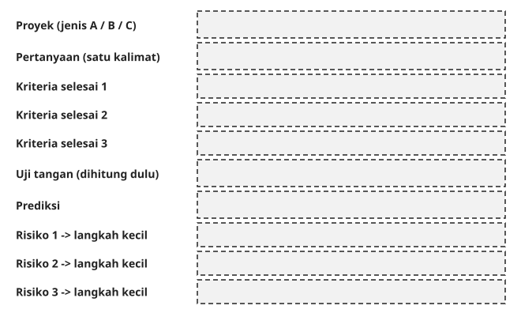

**Ingat dulu:** (1) Pada `c = 10^6`, pada ukuran ruang kunci berapa bit pencarian Grover mulai lebih murah daripada klasik? (2) Berapa pembacaan sirkuit untuk 40 iterasi dengan 4 pengaturan per iterasi dan 1000 shot?

______

`[Gambar: formulir dengan sepuluh kotak isian kosong: proyek (jenis A, B, atau C), pertanyaan satu kalimat, tiga kriteria selesai, uji tangan yang dihitung dulu, prediksi, dan tiga risiko dengan satu langkah kecil masing-masing.]`

**Latihan:**

1. Isi formulir pada gambar untuk proyekmu: pilih jenis proyek (A simulator, B algoritma, C studi banding), tulis pertanyaan satu kalimat, tiga kriteria selesai yang terukur (angka, bukan perasaan), satu uji tangan yang kamu hitung dengan kertas sebelum ada kode, prediksi beserta bagian yang kamu ragukan, dan tiga risiko dengan satu langkah kecil masing-masing.
2. Berapa memori vektor keadaan 25 qubit bila tiap amplitudo 8 byte, dan apakah itu cocok untuk proyek simulator di laptop? ______
3. Tentukan jumlah shot minimal agar setengah lebar selang 95 persen untuk peluang sekitar 0,5 paling besar 0,01. ______
4. Apa yang tidak boleh masuk ke dokumentasi atau portofolio? ______

**Cek diri:**

- [ ] Saya dapat menyatakan pertanyaan proyek dalam satu kalimat.
- [ ] Saya dapat menulis kriteria selesai yang terukur.
- [ ] Saya dapat menyebut tiga risiko dan langkah kecilnya.

**Catatan cetak (untuk guru, tidak dicetak):** satu halaman A4. Kunci ada di modul `e-xii2-m6` bagian "Kunci dan petunjuk". Bagian Prediksi, Lengkapi, dan Susun dilewati karena modul rancangan ini tidak memuatnya. Formulir tidak memuat kolom nama; berkas rancangan tidak boleh memuat data pribadi. Lembar tidak memuat kolom identitas.
