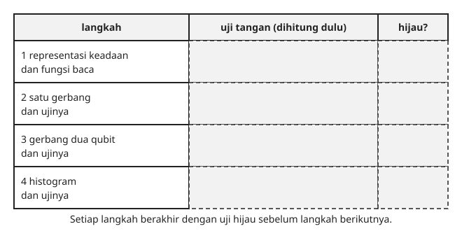

**Ingat dulu:** (1) Apa isi minimal dokumen rancangan proyek? (2) Sebutkan batas klaim yang harus ada pada laporan perbandingan simulator dan perangkat.

______

`[Gambar: tabel empat baris langkah sprint (representasi keadaan dan fungsi baca; satu gerbang dan ujinya; gerbang dua qubit dan ujinya; histogram dan ujinya). Kolom uji tangan yang dihitung dulu dan kolom hijau? kosong untuk diisi.]`

**Susun:** Tujuan sprint: "inti jalan dan tiga uji hitung tangan lulus". Pada gambar, tulis untuk tiap langkah satu uji tangan yang kamu hitung dengan kertas sebelum menulis kode. Lalu tandai kolom hijau? hanya setelah ujinya benar-benar lulus.

**Latihan:**

1. Dari 1000 shot GHZ, hasil `000` muncul 486 kali. Hitung `z` terhadap harapan 500. ______
2. Bila GHZ tiga qubit mengalami satu kesalahan bit-flip `X` pada qubit 2 setelah CNOT terakhir, hasil apa yang muncul bersama `000` dan `111`? ______
3. Mengapa kita menguji dengan jawaban hitung tangan sebelum menjalankan kode, bukan sesudahnya? ______
4. Bila uji GHZ gagal karena peluang `000` bukan 0,5, tiga hal apa yang diperiksa lebih dulu? ______
5. Tulis uji kecil yang menunjukkan bahwa gerbang `H` adalah kebalikan dirinya sendiri. ______

**Cek diri:**

- [ ] Saya dapat memecah proyek menjadi langkah kecil yang berakhir dengan uji hijau.
- [ ] Saya menulis jawaban hitung tangan sebelum kode.
- [ ] Saya dapat menjelaskan mengapa histogram diuji dengan simpangan wajar.

**Catatan cetak (untuk guru, tidak dicetak):** satu halaman A4. Kunci ada di modul `e-xii2-m7` bagian "Kunci dan petunjuk". Bagian Prediksi dan Lengkapi dilewati karena modul sprint ini tidak memuatnya. Lembar tidak memuat kolom identitas.
