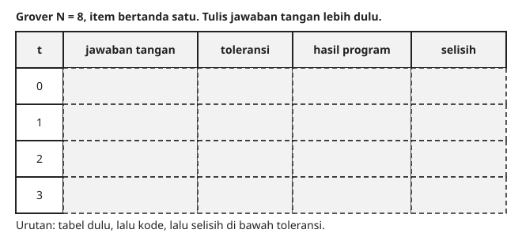

**Ingat dulu:** (1) Mengapa hasil yang cocok dengan perhitungan tangan lebih meyakinkan daripada hasil yang cocok dengan program yang sama? (2) Mengapa histogram 1000 shot dari peluang 0,5 tidak persis 500, dan berapa simpangan wajarnya?

______

`[Gambar: tabel dengan baris t = 0, 1, 2, 3 untuk Grover N = 8 dengan satu item bertanda. Kolom jawaban tangan, toleransi, hasil program, dan selisih kosong untuk diisi.]`

**Susun:** Tujuan sprint: "tabel uji hitung tangan untuk satu kasus yang lebih rumit lulus, dan uji mutasi gagal sebagaimana mestinya". Beri nomor 1 sampai 4 pada langkah berikut dan isi tabel pada gambar. Urutan: ______

- (A) Selisih harus di bawah toleransi.
- (B) Rusak satu bagian kode dengan sengaja; tabel harus gagal.
- (C) Tulis dulu tabel: `t`, jawaban tangan, toleransi.
- (D) Jalankan kode.

**Latihan:**

1. Tulis baris tabel uji untuk Grover `N = 4` dengan satu item bertanda dan `t = 1`, lengkap dengan jawaban tangannya. ______
2. Simulatormu memberi histogram 1000 shot dengan 790 hasil benar pada `N = 8`, `t = 1`. Hitung `z` terhadap harapan `25/32` dan nilailah. ______
3. Mengapa selisih di bawah toleransi pada satu kasus tidak membuktikan simulator benar untuk semua kasus? ______
4. Bila tabel uji tetap lulus setelah kode dirusak sengaja, apa artinya bagi tabel itu? ______

**Cek diri:**

- [ ] Saya dapat menulis tabel uji dengan jawaban tangan sebelum menjalankan kode.
- [ ] Saya dapat memilih toleransi eksak dan toleransi histogram.
- [ ] Saya dapat menjelaskan apa yang dibuktikan dan tidak dibuktikan oleh uji mutasi.

**Catatan cetak (untuk guru, tidak dicetak):** satu halaman A4. Kunci ada di modul `e-xii2-m8` bagian "Kunci dan petunjuk". Bagian Prediksi dan Lengkapi dilewati karena modul sprint ini tidak memuatnya. Lembar tidak memuat kolom identitas.
