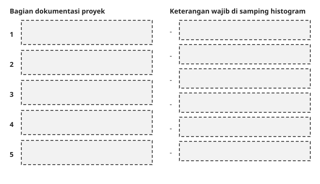

**Ingat dulu:** (1) Mengapa selisih di bawah toleransi pada satu kasus tidak membuktikan simulator benar untuk semua kasus? (2) Apa yang harus tertulis di samping sebuah histogram agar pembaca dapat menilainya?

______

`[Gambar: di kiri lima kotak isian kosong bernomor 1 sampai 5 untuk judul bagian dokumentasi proyek. Di kanan enam baris isian kosong untuk keterangan wajib di samping histogram.]`

**Susun:** Tujuan sprint: "orang yang belum pernah melihat proyekku dapat menjalankannya dan menilai hasilnya tanpa bertanya". Isi gambar: tulis lima bagian dokumentasi proyek dan keterangan wajib histogram. Lalu beri nomor 1 sampai 5 pada langkah berikut. Urutan: ______

- (A) Jalankan pemeriksa.
- (B) Perbaiki apa yang membuat temanmu bertanya.
- (C) Tulis lima bagian dokumentasi.
- (D) Minta temanmu menjalankan proyekmu hanya dari "Cara menjalankan".
- (E) Tambahkan keterangan wajib di tiap histogram.

**Latihan:**

1. Sebuah histogram 1000 shot dari simulator ideal ditulis tanpa keterangan apa pun. Sebutkan lima keterangan yang harus ditambahkan. ______
2. Tulis dua kalimat batas klaim untuk proyek Grover pada `N = 8` yang hanya simulasi. ______
3. Mengapa lolos dari pemeriksa pola belum berarti dokumentasi bebas data pribadi? ______
4. Mengapa batas klaim harus tertulis pada proyek yang hanya simulasi? ______

**Cek diri:**

- [ ] Saya dapat menyebut lima bagian dokumentasi proyek.
- [ ] Saya dapat menyebut keterangan wajib di samping histogram.
- [ ] Saya dapat menulis batas klaim yang jujur.

**Catatan cetak (untuk guru, tidak dicetak):** satu halaman A4. Kunci ada di modul `e-xii2-m9` bagian "Kunci dan petunjuk". Bagian Prediksi dan Lengkapi dilewati karena modul sprint ini tidak memuatnya. Lembar tidak memuat kolom identitas.
