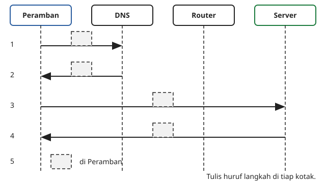

**Ingat dulu:** Tanpa melihat catatan, jawab.

1. Ubah `00010100` ke desimal. ______
2. Satu simbol heksadesimal mewakili berapa bit? ______
3. Berapa bit dalam satu byte, dan berapa nilai berbeda yang bisa disimpan satu byte? ______



`[Gambar: diagram urutan dengan empat kolom: Peramban, DNS, Router, Server. Ada empat panah bernomor 1 sampai 4 (Peramban ke DNS, DNS ke Peramban, Peramban lewat Router ke Server, Server ke Peramban) dan satu kotak bernomor 5 di samping Peramban. Tiap panah punya kotak kosong; kamu menulis huruf langkah dari soal Susun di kotak itu.]`

**Prediksi:** Sebelum menjalankan `ping -c 4 127.0.0.1`, tebak: apakah akan ada balasan walau komputer tidak tersambung ke jaringan apa pun? Tulis tebakan dan alasanmu. ______

**Lengkapi:** Alamat `192.0.2.80` terdiri dari 4 bilangan, tiap bilangan satu byte.

```text setengah-jadi
alamat IPv4 : 192 . 0 . 2 . 80
satu bagian : ______ bit
seluruh alamat : ______ bit
banyak alamat yang mungkin : 2^______
```

`ping` mengirim paket kecil ke sebuah alamat dan menunggu ______. Bila ada ______, jalur menuju alamat itu bekerja.

**Susun:** Urutkan alur halaman web.

- A. server mengirim paket halaman
- B. peramban bertanya ke DNS
- C. peramban menampilkan halaman
- D. peramban mengirim permintaan ke alamat IP
- E. DNS menjawab dengan alamat IP

Urutanku: ______ , ______ , ______ , ______ , ______

Tulis huruf langkah pada kotak di gambar.

**Latihan:**

1. Cocokkan: switch, router, klien, server, DNS, HTTPS dengan fungsinya: (a) menyediakan halaman, (b) menerjemahkan nama menjadi alamat IP, (c) menghubungkan dua jaringan berbeda, (d) meminta halaman, (e) menghubungkan perangkat dalam satu jaringan lokal, (f) mengirim halaman secara terenkripsi. ______
2. Apakah `192.0.2.300` alamat IPv4 yang sah? Mengapa? ______
3. Ubah bilangan `80` pada `192.0.2.80` ke biner 8 bit. ______
4. Sebuah berkas dipecah menjadi 5 paket. Paket nomor 3 hilang di jalan. Apa yang perlu dikirim ulang? Mengapa nomor urut penting? ______
5. Tahap berikut tercampur: (a) DNS, (b) layanan, (c) fisik, (d) gateway, (e) alamat IP. Susun menjadi urutan diagnosis, lalu tulis satu pertanyaan periksa untuk tiap tahap. ______

**Cek diri:**

- [ ] Aku bisa menjelaskan langkah dari mengetik alamat sampai halaman muncul.
- [ ] Aku bisa mendiagnosis gangguan sederhana dengan urutan yang benar.
- [ ] Aku bisa menggambar peta jaringan lab sederhana tanpa alamat nyata.

**Catatan cetak (untuk guru, tidak dicetak):** satu lembar A4 (satu halaman, bisa dua sisi bila ruang jawab diperbesar). Kunci ada di modul `fondasi-jaringan-dan-internet` bagian "Kunci dan petunjuk". Lembar tidak memuat kolom nama, kelas, tanggal, atau nilai.
