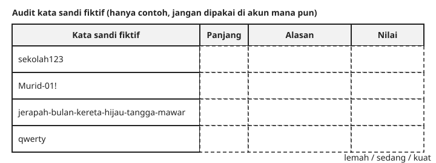

**Ingat dulu:** Tanpa melihat catatan, jawab.

1. Apa fungsi DNS? ______
2. Sebutkan lima tahap diagnosis jaringan dari yang pertama diperiksa. ______
3. Apa arti alamat `127.0.0.1`? ______



`[Gambar: tabel empat baris berisi kata sandi fiktif sekolah123, Murid-01!, jerapah-bulan-kereta-hijau-tangga-mawar, dan qwerty. Kolom Panjang, Alasan, dan Nilai kosong. Kamu mengisinya pada bagian Lengkapi; nilai dipilih dari lemah, sedang, kuat.]`

**Lengkapi:** Isi tabel pada gambar. Nilai tiap kata sandi: lemah, sedang, atau kuat. Tulis panjangnya dan satu alasan singkat (panjang, mudah ditebak atau tidak, ada hubungan dengan data pribadi atau tidak). Semua kata sandi di sini fiktif dan jangan dipakai di akun mana pun.

Faktor autentikasi: lengkapi dengan "yang kamu ______", "yang kamu ______", dan "siapa ______".

**Susun:** Susun respons yang aman terhadap pesan mencurigakan.

- A. buka situs resmi lewat alamat yang kamu ketik sendiri
- B. berhenti: jangan klik tautan dan jangan balas
- C. laporkan kepada guru atau orang dewasa tepercaya
- D. periksa tanda-tanda: mendesak? meminta kata sandi atau kode? alamat mirip tetapi beda?

Urutanku: ______ , ______ , ______ , ______

**Latihan:**

1. Berapa banyak kemungkinan kata sandi yang terdiri dari 6 huruf kecil? Tulis dengan 26^6. Bandingkan dengan 8 huruf kecil. ______
2. Apa yang kamu lakukan bila menerima pesan yang meminta kode verifikasimu? ______
3. Sebuah kafe fiktif menyediakan Wi-Fi tanpa kata sandi. Tulis tiga kebiasaan aman bila kamu terpaksa memakainya. ______
4. Pada contoh pesan sintetis berikut, tuliskan tiga tanda yang mencurigakan. ______

```text
Dari: layanan-akun@contoh-layanan.example
Isi : "Akunmu akan ditutup dalam 1 jam. Klik http://contoh-layanan.example/masuk
       dan masukkan kata sandimu untuk memastikan akunmu tetap aktif."
```

**Cek diri:**

- [ ] Aku bisa menilai kekuatan sebuah kata sandi dan menjelaskan alasannya.
- [ ] Aku bisa menjelaskan mengapa kode verifikasi tidak boleh dibagikan.
- [ ] Aku bisa menyebut langkah keamanan konektivitas dasar.

**Catatan cetak (untuk guru, tidak dicetak):** satu lembar A4 (satu halaman, bisa dua sisi bila ruang jawab diperbesar). Kunci ada di modul `fondasi-keamanan-dasar` bagian "Kunci dan petunjuk". Lembar tidak memuat kolom nama, kelas, tanggal, atau nilai.
