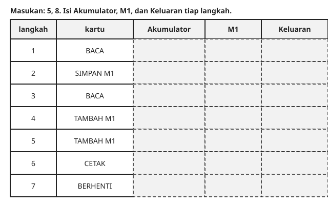

**Ingat dulu:** Jawab dari pengalamanmu sendiri tanpa mencari di mana pun; menebak boleh.

1. Sebutkan tiga perangkat yang menurutmu termasuk komputer. ______
2. Apa yang terjadi pada tulisan yang belum disimpan bila listrik tiba-tiba mati? Mengapa? ______
3. Menurutmu, apa beda "menyimpan" dan "membuka" sebuah berkas? ______



`[Gambar: tabel jejak dengan tujuh baris langkah. Kolom kartu sudah berisi BACA, SIMPAN M1, BACA, TAMBAH M1, TAMBAH M1, CETAK, BERHENTI. Kolom Akumulator, M1, dan Keluaran kosong. Di atas tabel tertulis masukan 5 dan 8. Kamu mengisinya pada Latihan 1.]`

**Prediksi:** Program kartu berikut menerima masukan `3, 4`. Tebak keluarannya dan tulis satu alasan. ______

```text
Kartu 1: BACA
Kartu 2: SIMPAN M1
Kartu 3: BACA
Kartu 4: TAMBAH M1
Kartu 5: CETAK
Kartu 6: BERHENTI
```

**Lengkapi:** Isi lembar spesifikasi komputer lab. Tulis "tidak terbaca" bila informasinya tidak muncul.

| Butir | Isi |
| --- | --- |
| Nama sistem operasi dan versinya | |
| Jenis dan nama prosesor | |
| Jumlah inti prosesor | |
| Kapasitas memori (RAM) | |
| Jenis dan kapasitas penyimpanan | |
| Resolusi layar | |

**Susun:** Enam kartu berikut tercampur. Susun menjadi program yang membaca dua angka lalu mencetak jumlahnya. Tiap kartu dipakai tepat satu kali.

- A. CETAK
- B. TAMBAH M1
- C. BACA
- D. BERHENTI
- E. SIMPAN M1
- F. BACA

Urutanku: ______ , ______ , ______ , ______ , ______ , ______

**Latihan:**

1. Isi tabel pada gambar untuk masukan `5, 8`. Berapa keluarannya? ______
2. Pada program contoh di bagian Prediksi, apa yang terjadi bila kartu `SIMPAN M1` dilewati? Berapa keluarannya untuk masukan `3, 4`? ______
3. Cocokkan: 1. CPU, 2. RAM, 3. SSD, 4. Papan induk, 5. Catu daya dengan (a) menyimpan berkas tetap, (b) menghubungkan semua komponen, (c) menjalankan instruksi, (d) menampung program dan data yang sedang dipakai, (e) menyediakan tegangan listrik yang sesuai. ______
4. Kelompokkan sebagai masukan atau keluaran: papan ketik, layar, mikrofon, pengeras suara, pemindai kode batang, pencetak, layar sentuh. ______

**Cek diri:**

- [ ] Aku bisa menyebut fungsi tujuh komponen utama komputer.
- [ ] Aku bisa menjelaskan siklus ambil-jalankan dengan kata-kataku.
- [ ] Aku bisa membaca informasi prosesor, memori, dan penyimpanan dari komputer lab.

**Catatan cetak (untuk guru, tidak dicetak):** satu lembar A4 (satu halaman, bisa dua sisi bila ruang jawab diperbesar). Kunci ada di modul `fondasi-komputer-dan-hardware` bagian "Kunci dan petunjuk". Lembar tidak memuat kolom nama, kelas, tanggal, atau nilai.
