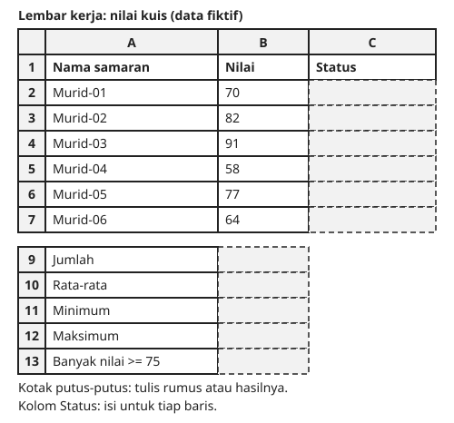

**Ingat dulu:** Tanpa melihat catatan, jawab.

1. Apa itu atribusi? Tulis contohnya untuk foto fiktif "Gedung Lab" karya Pembuat-Fiktif berlisensi Lisensi Contoh 1.0. ______
2. Tulis nama berkas yang rapi untuk "Laporan Minggu 7 FINAL (2).docx" milik Murid-01. ______
3. Apa beda perangkat lunak sistem dan perangkat lunak aplikasi? Pengolah dokumen termasuk yang mana? ______



`[Gambar: tabel lembar kerja. Kolom A nama samaran Murid-01 sampai Murid-06, kolom B nilai 70, 82, 91, 58, 77, 64 pada baris 2 sampai 7, kolom C Status kosong. Di bawahnya lima baris berlabel Jumlah, Rata-rata, Minimum, Maksimum, dan Banyak nilai minimal 75, dengan sel B kosong untuk rumus dan hasilnya. Kamu mengisinya pada soal Latihan.]`

**Prediksi:** Nilai kuis lima murid samaran: 80, 75, 90, 65, 85. Sebelum memakai lembar kerja, hitung dengan tangan jumlah dan rata-ratanya, lalu tebak: berapa murid yang berstatus "Tuntas" bila batasnya 75? ______

**Lengkapi:** Kolom C berisi status. Lengkapi rumus di C2 agar menampilkan "Tuntas" bila nilai minimal 75, selain itu "Remedial".

```text setengah-jadi
=IF(____, "Tuntas", ____)
```

Rumus apa yang menghitung berapa murid berstatus "Remedial"? ______

**Susun:** Susun langkah kerja rekap nilai sintetis.

- A. buat grafik batang dari kolom nama samaran dan nilai
- B. ketik judul kolom: Nama samaran, Nilai
- C. tulis rumus jumlah, rata-rata, minimum, maksimum yang merujuk ke rentang sel
- D. isi data Murid-01 sampai Murid-06
- E. simpan sebagai lembar kerja dan, bila perlu, ekspor ke PDF

Urutanku: ______ , ______ , ______ , ______ , ______

**Latihan:**

1. Pilih perangkat (dokumen, lembar kerja, atau presentasi) untuk: (a) surat permohonan peminjaman ruang, (b) daftar iuran kas kelas dengan total, (c) paparan hasil penelitian di depan kelas. ______
2. Pada gambar, nilai ada di `B2` sampai `B7`. Tulis rumus dan hasil untuk jumlah, rata-rata (bulatkan dua desimal), minimum, maksimum, dan banyak murid dengan nilai minimal 75. ______
3. Grafik batang menunjukkan nilai 58 sampai 91, tetapi sumbu vertikal dimulai dari 50. Mengapa ini bisa menyesatkan? ______
4. Kamu perlu mengirim laporan akhir kepada guru yang hanya akan membacanya, dan lembar kerja kepada temanmu yang perlu menyuntingnya. Format apa yang kamu pilih untuk masing-masing? ______

**Cek diri:**

- [ ] Aku bisa memilih perangkat yang cocok untuk suatu tugas.
- [ ] Aku bisa menulis rumus dasar dan membuat grafik.
- [ ] Aku bisa menyimpan berkas dalam format yang dapat dibuka di perangkat lain.

**Catatan cetak (untuk guru, tidak dicetak):** satu lembar A4 (satu halaman, bisa dua sisi bila ruang jawab diperbesar). Kunci ada di modul `fondasi-perangkat-produktivitas` bagian "Kunci dan petunjuk". Lembar tidak memuat kolom nama, kelas, tanggal, atau nilai.
