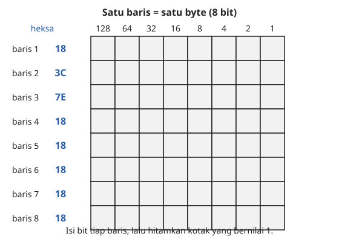

**Ingat dulu:** Tanpa melihat catatan, jawab.

1. Apa yang disimpan memori komputer Von Neumann, selain data?
2. Mengapa sebuah berkas yang ekstensinya diganti dari `.txt` menjadi `.png` tidak berubah menjadi gambar?



`[Gambar: tabel kosong 8 baris dan 8 kolom. Kolom diberi nilai tempat 128, 64, 32, 16, 8, 4, 2, 1. Baris 1 sampai 8 punya byte heksadesimal 18, 3C, 7E, 18, 18, 18, 18, 18. Kotak bit kosong; kamu mengisinya dengan 0 atau 1 pada soal Latihan.]`

**Prediksi:** Tanpa menghitung rinci, apakah `00110101` lebih besar atau lebih kecil dari 64? Mengapa? ______

**Lengkapi:** Biner ke desimal dengan nilai tempat.

```text setengah-jadi
nilai tempat : 128 64 32 16  8  4  2  1
bit          :   0  0  1  1  0  1  0  1
yang dijumlah:  ______ + ______ + ______ + ______  = ______
```

Desimal ke biner: 202. Mulai dari 128: 128 muat? ______. 64 muat? ______. Lanjutkan sampai nilai tempat 1, lalu tulis `______ ______ ______ ______ ______ ______ ______ ______`.

**Susun:** Urutkan langkah mengubah desimal ke biner 8 bit dengan pengurangan.

- A. ulangi untuk nilai tempat berikutnya sampai nilai tempat 1
- B. tulis nilai tempat 128 64 32 16 8 4 2 1
- C. bila nilai tempat muat, tulis bit 1 lalu kurangkan; bila tidak, tulis bit 0
- D. cek: jumlahkan nilai tempat yang bit-nya 1
- E. mulai dari nilai tempat terbesar

Urutanku: ______ , ______ , ______ , ______ , ______

**Latihan:**

1. Ubah ke desimal: `1111`, `10000000`, `01001101`. ______
2. Ubah ke biner 8 bit: 37 dan 100. ______
3. Ubah `00111111` dan `10100101` ke heksadesimal. ______
4. Sandikan `KOPI` ke deret kode desimal memakai tabel kode karakter di modul. ______
5. Isi kisi pada gambar: ubah tiap byte heksadesimal ke bit, lalu hitamkan kotak bernilai 1. Bentuk apa yang muncul? ______ Berapa byte yang dibutuhkan gambar hitam-putih 8x8? ______
6. Tulis kode heksadesimal warna R = 255, G = 255, B = 0. ______

**Cek diri:**

- [ ] Aku bisa mengubah biner, desimal, dan heksadesimal dengan lembar kerja.
- [ ] Aku bisa menjelaskan mengapa `KOPI` dapat disimpan sebagai angka.
- [ ] Aku bisa menggambar gambar 8x8 dari deret bit.

**Catatan cetak (untuk guru, tidak dicetak):** satu lembar A4 (satu halaman, bisa dua sisi bila ruang jawab diperbesar). Kunci ada di modul `fondasi-representasi-data` bagian "Kunci dan petunjuk". Lembar tidak memuat kolom nama, kelas, tanggal, atau nilai.
