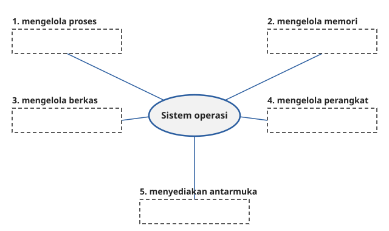

**Ingat dulu:** Tanpa membuka modul sebelumnya, jawab.

1. Apa beda memori (RAM) dan penyimpanan? Mana yang isinya hilang saat listrik mati?
2. Pada program kartu `BACA, SIMPAN M1, BACA, TAMBAH M1, CETAK`, berapa keluaran untuk masukan `2, 9`?



`[Gambar: "Sistem operasi" di tengah, dengan lima cabang bernomor: 1 mengelola proses, 2 mengelola memori, 3 mengelola berkas, 4 mengelola perangkat, 5 menyediakan antarmuka. Tiap cabang berujung kotak kosong bergaris putus-putus untuk satu contoh nyata di komputer lab.]`

**Prediksi:** Berapa kira-kira jumlah proses yang berjalan di komputer lab saat hanya satu aplikasi terbuka: puluhan, ratusan, atau kurang dari sepuluh? Tulis tebakanmu: ______

**Lengkapi:** Baca teks lisensi fiktif berikut (bukan lisensi sungguhan), lalu isi tabel.

```text
LISENSI CONTOH 1.0 (FIKTIF, UNTUK LATIHAN)
Kamu boleh memakai, menyalin, dan mengubah karya ini, termasuk untuk tujuan komersial.
Kamu wajib mencantumkan nama pembuat asli pada setiap salinan.
Kamu wajib membagikan karya hasil ubahanmu dengan lisensi yang sama.
Karya ini diberikan apa adanya, tanpa jaminan apa pun.
```

| Pertanyaan | Jawabanmu |
| --- | --- |
| Boleh dipakai? | |
| Boleh diubah? | |
| Boleh dijual? | |
| Apa kewajibanmu? | |
| Ada jaminan dari pembuat? | |

**Susun:** Urutkan langkah menata tugasmu di akun uji. Tiap langkah dipakai satu kali.

- A. pindahkan berkas ke folder yang sesuai
- B. buat folder induk "Tugas-Informatika"
- C. ganti nama berkas yang berantakan menjadi nama yang menjelaskan isi
- D. buat subfolder "Minggu-02" di dalamnya
- E. simpan salinan berkas penting di tempat lain

Urutanku: ______ , ______ , ______ , ______ , ______

**Latihan:**

1. Kelompokkan sebagai perangkat lunak sistem atau aplikasi: sistem operasi, pengolah kata, driver pencetak, peramban, pemutar video, pengelola tugas. ______
2. Cocokkan tiap situasi dengan peran sistem operasi: (a) dua program berjalan bersamaan tanpa saling merusak datanya; (b) kamu mencetak dan pencetak merespons; (c) kamu mencari berkas lewat namanya. ______
3. Perbaiki nama berkas sesuai aturan penamaan: `Tugas Informatika Baru!!!.docx` (laporan minggu 2 oleh Murid-01), `FOTO 1.PNG` (foto ruang lab), `ok (2).txt` (catatan proses). ______
4. Sebuah aplikasi gratis diunduh, tetapi kodenya tidak boleh dilihat dan tidak boleh dibagikan. Apa jenis lisensinya? Mengapa "gratis" tidak sama dengan "sumber terbuka"? ______
5. Isi lima kotak pada gambar: satu contoh nyata di komputer lab untuk tiap peran sistem operasi.

**Cek diri:**

- [ ] Aku bisa memberi contoh perangkat lunak sistem dan aplikasi.
- [ ] Aku bisa menata folder dan menamai berkas dengan rapi.
- [ ] Aku bisa membaca lisensi sederhana dan mengatakan apa yang boleh dan wajib.

**Catatan cetak (untuk guru, tidak dicetak):** satu lembar A4 (satu sampai dua halaman). Kunci ada di modul `fondasi-software-dan-sistem-operasi` bagian "Kunci dan petunjuk". Lembar tidak memuat kolom nama, kelas, tanggal, atau nilai.
