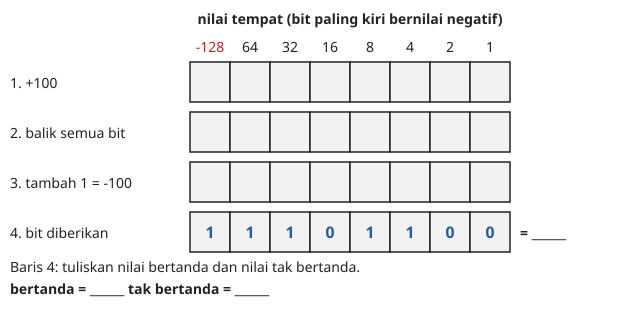

**Ingat dulu:** Tanpa membuka modul sebelumnya, jawab.

1. Ubah 217 ke biner dengan bagi berulang. Dari ujung mana sisa dibaca?
2. Hitung `1011₂ + 110₂` dan cek dalam desimal.
3. Berapa banyak pola berbeda pada n bit?



`[Gambar: baris nilai tempat 8 bit komplemen dua -128, 64, 32, 16, 8, 4, 2, 1. Di bawahnya tiga baris kotak kosong: tulis 100, hasil membalik semua bit, dan hasil menambah 1. Baris keempat berisi bit 11101100 dengan ruang untuk nilai bertanda dan tak bertanda.]`

**Prediksi:** Pada 8 bit tak bertanda, berapa hasil tersimpan untuk 200 + 100? Apakah `0.1 + 0.2 == 0.3` bernilai benar di komputer? Tulis tebakanmu: ______

**Lengkapi:** Pemeriksaan sebelum menjumlah pada tipe `int` bila `b` negatif.

```cpp setengah-jadi
if (b < 0 && a < ____ - b) {
    return false;  // tidak muat
}
```

**Susun:** Urutkan langkah membuat -x dari x (8 bit). Lalu terapkan untuk x = 20 pada kertas.

- A. tambah 1 pada hasilnya
- B. tulis x dalam biner 8 bit
- C. cek: jumlahkan dengan x, hasilnya harus 0 setelah bit ke-9 dibuang
- D. balik semua bit (0 jadi 1, 1 jadi 0)

Urutanku: ______ , ______ , ______ , ______

**Latihan:**

1. Tuliskan -100 dalam komplemen dua 8 bit memakai baris 1 sampai 3 pada gambar. Cek dengan penjumlahan. ______
2. Baris 4 pada gambar berisi `11101100`. Berapa nilai desimalnya bila dibaca tak bertanda, dan bila dibaca bertanda? ______
3. Tulis rentang bilangan bertanda pada 12 bit dan pada 16 bit. ______
4. Sebuah program menjumlah 100.000 nilai, masing-masing paling besar 50.000. Apakah jumlahnya muat dalam 32 bit bertanda? Tipe apa yang aman? ______
5. Jelaskan mengapa `0.1 + 0.2 != 0.3` tetapi `0.5 + 0.25 == 0.75` dalam komputer. Tulis cara membandingkan pecahan yang aman. ______

**Cek diri:**

- [ ] Aku bisa menjelaskan langkah membuat -x dari x dalam komplemen dua.
- [ ] Aku bisa menyebut rentang bilangan bertanda n bit.
- [ ] Aku bisa menjelaskan mengapa `0.1 + 0.2` tidak persis `0.3`, dan apa pengganti `==`.

**Catatan cetak (untuk guru, tidak dicetak):** satu lembar A4 (dua halaman bila ruang jawab diperlukan). Kunci ada di modul `matkom-bilangan-bertanda-dan-luapan` bagian "Kunci singkat". Lembar tidak memuat kolom nama, kelas, tanggal, atau nilai.
