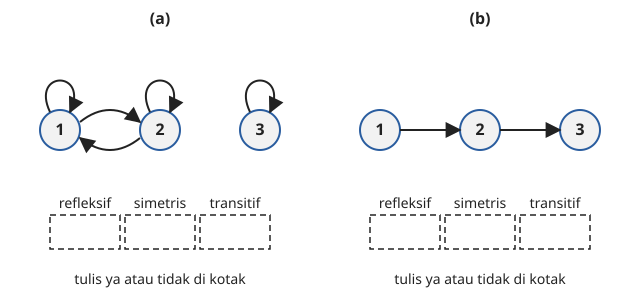

**Ingat dulu:** Tanpa membuka modul `matkom-logika-proposisi`, jawab.

1. Kapan implikasi p → q bernilai salah?
2. Tulis negasi dari "semua bilangan di daftar positif".



`[Gambar: dua graf berarah pada simpul 1, 2, 3. Graf (a): setiap simpul punya panah ke dirinya sendiri, ditambah panah 1 ke 2 dan 2 ke 1. Graf (b): panah 1 ke 2 dan panah 2 ke 3. Di bawah tiap graf ada tiga kotak kosong berlabel refleksif, simetris, transitif untuk diisi ya atau tidak.]`

**Prediksi:** Pada A = {1, 2, 3}, relasi R₂ = {(1,2), (2,1)}. Apakah R₂ refleksif? simetris? transitif? Tulis tebakanmu, lalu periksa dengan definisi sifat: ______

**Lengkapi:** Pemeriksaan transitif: bila `(x, y)` dan `(p, z)` ada dan `y == p`, maka `(x, z)` harus ada.

```cpp setengah-jadi
for (auto [x, y] : r) {
    for (auto [p, z] : r) {
        if (y == ____ && !r.count({____, z})) {
            return false;
        }
    }
}
```

**Susun:** Empat baris berikut tercampur. Susun menjadi fungsi yang memeriksa sifat simetris sebuah relasi.

- A. `return true;`
- B. `}`
- C. `for (auto [x, y] : r) if (!r.count({y, x})) return false;`
- D. `bool simetris(const Relasi& r) {`

Urutanku: ______ , ______ , ______ , ______

**Latihan:**

1. Misalkan U = {1, ..., 12}, A = {2, 4, 6, 8, 10, 12}, B = {3, 6, 9, 12}. Tulis A ∪ B, A ∩ B, A − B, dan Bᶜ. ______
2. Di sebuah angkatan fiktif 120 siswa, 70 menyukai informatika, 55 menyukai matematika, dan 25 menyukai keduanya. Berapa yang menyukai paling sedikit satu? Berapa yang tidak menyukai keduanya? ______
3. Pada gambar, tuliskan pasangan relasi tiap graf, lalu isi kotak refleksif, simetris, dan transitif. ______
4. Pada A = {1, 2, 3, 4} dan B = {x, y}, apakah {(1,x), (2,y), (3,x)} fungsi? Bila bukan, mengapa? ______
5. Berapa banyak fungsi dari {1, 2, 3} ke {p, q, r, s, t}? Berapa di antaranya satu-satu? ______

**Cek diri:**

- [ ] Aku bisa menuliskan rumus inklusi-eksklusi untuk dua himpunan.
- [ ] Aku bisa menyebut tiga sifat relasi dan tampilannya pada graf.
- [ ] Aku bisa menjelaskan beda satu-satu dan pada.

**Catatan cetak (untuk guru, tidak dicetak):** satu lembar A4 (dua halaman bila ruang jawab diperlukan). Kunci ada di modul `matkom-himpunan-relasi-fungsi` bagian "Kunci singkat". Lembar tidak memuat kolom nama, kelas, tanggal, atau nilai.
