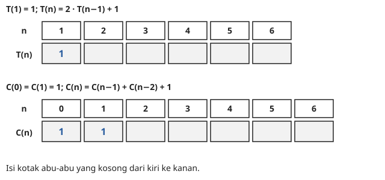

**Ingat dulu:** Tanpa membuka modul sebelumnya, jawab.

1. Kapan p → q salah, dan apa kontrapositifnya?
2. Berapa banyak himpunan bagian dari himpunan dengan 4 anggota?
3. Dalam kata-kata, apa arti "untuk semua x berlaku P(x)", dan apa satu contoh tandingan?



`[Gambar: dua tabel penelusuran. Tabel pertama untuk T(n), n dari 1 sampai 6, dengan T(1) = 1 dan kotak lain kosong. Tabel kedua untuk C(n), n dari 0 sampai 6, dengan C(0) = C(1) = 1 dan kotak lain kosong. Aturan tiap tabel tertulis di atasnya.]`

**Prediksi:** Menurut tabel T(n) pada gambar, tebak: berapa langkah untuk 5 cakram menara Hanoi? Tulis tebakanmu: ______

**Lengkapi:** Fungsi rekursif menara Hanoi sesuai T(n) = 2T(n−1) + 1.

```cpp setengah-jadi
long long hanoi(int n) {
    if (n == ____) {
        return 1;
    }
    return ____ * hanoi(n - 1) + ____;
}
```

**Susun:** Kalimat berikut adalah bagian bukti induksi untuk 1 + 2 + ... + n = n(n+1)/2, tetapi tercampur. Susun menjadi bukti yang runtut.

- A. Hipotesis: andaikan 1 + 2 + ... + k = k(k+1)/2 untuk suatu k ≥ 1.
- B. Kesimpulan: rumus benar untuk semua n ≥ 1.
- C. Basis: untuk n = 1, ruas kiri 1 dan ruas kanan 1·2/2 = 1.
- D. Langkah: 1 + ... + k + (k+1) = k(k+1)/2 + (k+1) = (k+1)(k+2)/2.

Urutanku: ______ , ______ , ______ , ______

**Latihan:**

1. Buktikan dengan induksi: 2 + 4 + 6 + ... + 2n = n(n+1). Tulis basis, hipotesis, dan langkah. ______
2. Isi tabel T(n) pada gambar. Berapa langkah untuk 6 cakram? ______
3. Isi tabel C(n) pada gambar sampai C(6). Berapa banyak panggilan `fib(6)`? ______
4. Klaim: 1 + 2 + ... + n = n(n+1)/2 + 1 untuk semua n ≥ 1. "Bukti": andaikan benar untuk k. Untuk k+1: k(k+1)/2 + 1 + (k+1) = (k+1)(k+2)/2 + 1, sesuai rumus. Mengapa klaim itu salah padahal langkahnya benar? ______
5. Sebuah perulangan menghitung faktorial: `hasil = 1; untuk i dari 1 sampai n: hasil = hasil * i`. Tuliskan invariannya dan jelaskan mengapa hasil akhirnya n!. ______

**Cek diri:**

- [ ] Aku bisa menyebut tiga bagian bukti induksi.
- [ ] Aku bisa menjelaskan mengapa basis wajib.
- [ ] Aku bisa menuliskan hubungan rekurens untuk Hanoi.

**Catatan cetak (untuk guru, tidak dicetak):** satu lembar A4 (dua halaman bila ruang jawab diperlukan). Kunci ada di modul `matkom-induksi-dan-rekursi-matematis` bagian "Kunci singkat". Lembar tidak memuat kolom nama, kelas, tanggal, atau nilai.
