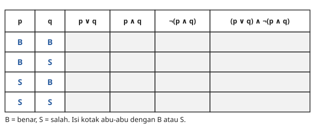

**Ingat dulu:** Jawab tanpa mencari.

1. Tulis tiga bilangan bulat yang memenuhi `x > 3 && x < 7`.
2. Apa beda `=` dan `==` di C++ atau JavaScript?
3. Berapa pola berbeda yang bisa dibentuk 3 bit?



`[Gambar: tabel empat baris dengan kolom p, q, p ∨ q, p ∧ q, ¬(p ∧ q), dan (p ∨ q) ∧ ¬(p ∧ q). Kolom p dan q berisi B dan S untuk empat kombinasi; empat kolom lain kosong untuk diisi B atau S.]`

**Prediksi:** Implikasi p → q salah hanya bila p benar dan q salah. Menurut tebakanmu, apakah p → q selalu sama nilainya dengan `!p || q`? Tulis tebakan dan alasanmu: ______

**Lengkapi:** Fungsi "ada bilangan genap di daftar".

```cpp setengah-jadi
bool adaGenap(const vector<int>& daftar) {
    for (int x : daftar) if (x % ____ == 0) return ____;
    return ____;
}
```

**Susun:** Empat baris berikut tercampur. Susun menjadi fungsi yang benar untuk "semua bilangan di daftar positif".

- A. `return true;`
- B. `for (int x : daftar) if (x <= 0) return false;`
- C. `bool semuaPositif(const vector<int>& daftar) {`
- D. `}`

Urutanku: ______ , ______ , ______ , ______

Apa yang dikembalikan untuk daftar kosong? ______

**Latihan:**

1. Isi tabel pada gambar. Konektif apa yang setara dengan kolom terakhir? ______
2. Sederhanakan `!(a > 0 && b > 0)` dan `!(s == 1 || s == 2)`. ______
3. Tulis kontrapositif, konvers, dan invers dari "Jika n habis dibagi 6, maka n genap". Mana yang selalu benar? Mana yang punya contoh tandingan? ______
4. Tulis ulang `!(umur < 17) && !(umur > 60)` tanpa tanda `!`, lalu sebutkan rentangnya. ______
5. Tulis negasi dari (a) "semua siswa di daftar hadir" dan (b) "ada nilai di bawah 50". ______
6. Kondisi `1 <= n <= 9 || n == 100` dimaksudkan untuk "n di antara 1 dan 9, atau n sama dengan 100". Mengapa ia menerima n = -5, dan bagaimana memperbaikinya? ______

**Cek diri:**

- [ ] Aku bisa menyebut kapan p → q salah.
- [ ] Aku bisa menuliskan hukum De Morgan untuk dan serta atau.
- [ ] Aku bisa menjelaskan mengapa `i < n && data[i] > 0` aman tetapi urutan terbalik berisiko.

**Catatan cetak (untuk guru, tidak dicetak):** satu lembar A4 (dua halaman bila ruang jawab diperlukan). Kunci ada di modul `matkom-logika-proposisi` bagian "Kunci singkat". Lembar tidak memuat kolom nama, kelas, tanggal, atau nilai.
