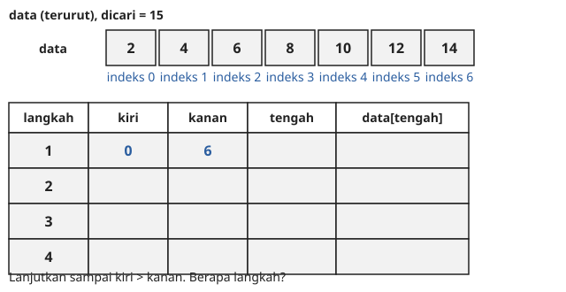

**Ingat dulu:** Tanpa membuka modul sebelumnya, jawab.

1. Ubah 100 ke biner dengan bagi berulang. Berapa kali pembagian yang dilakukan?
2. Tulis hubungan rekurens banyak langkah menara Hanoi, dan nilainya untuk 4 cakram.
3. Berapa nilai terbesar yang muat pada 10 bit tanpa tanda minus?



`[Gambar: larik terurut tujuh elemen, indeks 0 sampai 6, berisi 2, 4, 6, 8, 10, 12, 14; nilai yang dicari 15. Di bawahnya tabel jejak dengan kolom langkah, kiri, kanan, tengah, dan data[tengah]. Baris pertama berisi kiri 0 dan kanan 6; sisanya kosong untuk diisi.]`

**Prediksi:** Untuk 1.000.000 data terurut dan nilai yang dicari tidak ada, berapa langkah pencarian sekuensial dan berapa langkah pencarian biner (paling banyak)? Tulis tebakanmu: ______

**Lengkapi:** Penghitung langkah untuk perulangan yang menggandakan. Lalu tulis notasi O-nya.

```cpp setengah-jadi
long long langkah = 0;
for (long long i = 1; i < n; i = i * ____) {
    langkah++;
}
```

Notasi O: ______

**Susun:** Sembilan baris berikut tercampur. Susun menjadi pencarian biner yang mengembalikan indeks, atau -1 bila tidak ada. Tiap baris dipakai satu kali.

- A. `if (data[tengah] < dicari) kiri = tengah + 1; else kanan = tengah - 1;`
- B. `return -1;`
- C. `while (kiri <= kanan) {`
- D. `int cariBiner(const vector<int>& data, int dicari) {`
- E. `int tengah = kiri + (kanan - kiri) / 2;`
- F. `}   // menutup fungsi`
- G. `int kiri = 0, kanan = (int)data.size() - 1;`
- H. `if (data[tengah] == dicari) return tengah;`
- I. `}   // menutup perulangan`

Urutanku: ______ , ______ , ______ , ______ , ______ , ______ , ______ , ______ , ______

**Latihan:**

1. Berapa kira-kira log₂ 64 dan log₂ 1.000.000? Berapa kali 100 dapat dibagi dua (dibulatkan ke bawah) sampai tinggal 1? ______
2. Berapa kali `hitung++` dijalankan untuk n = 1024? (a) `untuk i dari 1 sampai n: hitung++`; (b) dua perulangan bersarang masing-masing sampai n; (c) `i = 1; selama i < n: hitung++; i = i · 2`. ______
3. Tuliskan notasi O: (a) 4n + 20, (b) 2n² + 100n, (c) 7, (d) 3n log n + 10n, (e) n(n+1)/2. ______
4. Telusuri pencarian biner pada gambar dengan dicari = 15. Isi tabel jejak sampai kiri > kanan. Berapa langkahnya? ______
5. Soal berbatas n sampai 200.000. Solusimu O(n²). Kira-kira berapa langkah, dan cukup cepatkah (anggaran 10⁸ langkah per detik)? Apa alternatifnya? ______
6. Solusi P butuh 50n langkah, solusi Q butuh n² langkah. Untuk n berapa Q lebih cepat, dan untuk n berapa P lebih cepat? ______

**Cek diri:**

- [ ] Aku bisa menjelaskan log₂ n sebagai "berapa kali dibagi dua".
- [ ] Aku bisa menyederhanakan 5n² + 3n + 9 ke notasi O.
- [ ] Aku bisa menjelaskan mengapa batas masukan penting untuk memilih solusi.

**Catatan cetak (untuk guru, tidak dicetak):** satu lembar A4 (dua halaman bila ruang jawab diperlukan). Kunci ada di modul `matkom-pertumbuhan-fungsi` bagian "Kunci singkat". Lembar tidak memuat kolom nama, kelas, tanggal, atau nilai.
