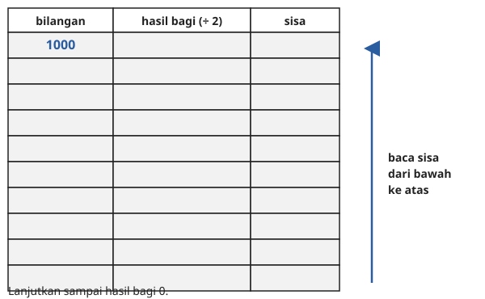

**Ingat dulu:** Tanpa membuka modul representasi data, jawab.

1. Berapa nilai terbesar yang muat pada 8 bit tanpa tanda minus, dan berapa banyak nilai berbeda?
2. Satu simbol heksadesimal mewakili berapa bit?
3. Ubah 100 ke biner 8 bit.



`[Gambar: tabel tiga kolom (bilangan, hasil bagi ÷ 2, sisa) dengan sepuluh baris. Baris pertama berisi bilangan 1000; kotak lain kosong. Panah di kanan tabel menunjuk ke atas dengan tulisan "baca sisa dari bawah ke atas".]`

**Prediksi:** Menurutmu, 3E8 (basis 16) lebih besar atau lebih kecil dari 1000 desimal? Tulis tebakanmu: ______

**Lengkapi:** Mengubah teks biner menjadi nilai, tanpa fungsi konversi bawaan.

```cpp setengah-jadi
long long dariBiner(const string& teks) {
    long long hasil = 0;
    for (char c : teks) {
        hasil = hasil * ____ + (c - '____');
    }
    return hasil;
}
```

**Susun:** Baris badan fungsi `keBasis` berikut tercampur (bagian `if (n == 0)` dilewati). Susun menjadi badan fungsi yang benar. Tiap baris dipakai satu kali.

- A. `reverse(hasil.begin(), hasil.end());`
- B. `hasil += angka[n % basis];`
- C. `while (n > 0) {`
- D. `n /= basis;`
- E. `return hasil;`
- F. `string hasil;`
- G. `}`

Urutanku: ______ , ______ , ______ , ______ , ______ , ______ , ______

**Latihan:**

1. Ubah ke desimal: (a) `101101₂`, (b) `364 (basis 8)`, (c) `2F (basis 16)`. ______
2. Isi tabel pada gambar untuk mengubah 1000 ke biner. Turunkan oktal dan heksadesimalnya lewat biner (kelompok 3 bit dan 4 bit dari kanan). ______
3. Ubah `7C5 (basis 16)` ke oktal tanpa lewat desimal. ______
4. Hitung `110101₂ + 10111₂` dan `100000₂ - 1011₂`, lalu cek dalam desimal. ______
5. Ubah 0,8125 ke biner. Apakah 0,3 desimal punya bentuk biner berhingga? Berikan alasan. ______

**Cek diri:**

- [ ] Aku bisa menjelaskan mengapa angka tertinggi di basis b adalah b - 1.
- [ ] Aku bisa mengubah `1011 0110₂` ke heksadesimal tanpa menghitung desimalnya.
- [ ] Aku bisa menjelaskan mengapa 0,1 desimal tidak persis tersimpan dalam biner.

**Catatan cetak (untuk guru, tidak dicetak):** satu lembar A4 (dua halaman bila ruang jawab diperlukan). Kunci ada di modul `matkom-sistem-bilangan-basis` bagian "Kunci singkat". Lembar tidak memuat kolom nama, kelas, tanggal, atau nilai.
