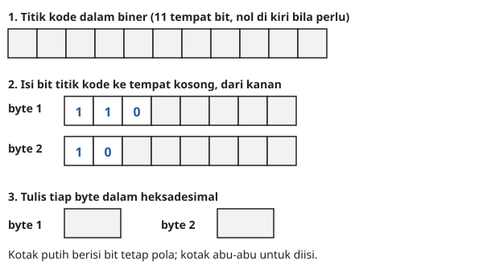

**Ingat dulu:** Tanpa membuka modul sebelumnya, jawab.

1. Berapa kode ASCII huruf `K` bila `A` = 65?
2. Satu piksel RGB 24 bit memakai berapa byte? Tulis kode heksadesimal warna kuning (R = 255, G = 255, B = 0).
3. Ubah `A5` heksadesimal ke biner 8 bit.



`[Gambar: tiga bagian. Atas: 11 kotak kosong untuk titik kode dalam biner. Tengah: byte 1 dengan bit tetap 1, 1, 0 lalu lima kotak kosong; byte 2 dengan bit tetap 1, 0 lalu enam kotak kosong. Bawah: dua kotak kosong untuk byte 1 dan byte 2 dalam heksadesimal.]`

**Prediksi:** `"caf\xC3\xA9"` adalah `café` ditulis dengan byte UTF-8 (`C3 A9` untuk `é`). Berapa `kafe.size()` di C++, dan berapa karakter yang sebenarnya? Tulis tebakanmu: ______

**Lengkapi:** Pengodean RLE: baris yang hilang memajukan penunjuk ke awal kelompok berikutnya.

```cpp setengah-jadi
while (i < s.size()) {
    size_t j = i;
    while (j < s.size() && s[j] == s[i]) {
        j++;
    }
    hasil += to_string(j - i);
    hasil += s[i];
    ____ = j;
}
```

**Susun:** Langkah menyandikan satu titik kode ke UTF-8 berikut tercampur. Susun menjadi urutan yang benar.

- A. isi bit titik kode ke tempat `x` pada pola, dari kanan
- B. tentukan rentang titik kode, sehingga tahu banyak byte dan polanya
- C. ubah titik kode ke biner
- D. tulis tiap byte dalam heksadesimal

Urutanku: ______ , ______ , ______ , ______

**Latihan:**

1. Berapa kode ASCII `'M'` bila `'A'` = 65? Berapa kode `'m'`? Berapa nilai `'8' - '0'`? ______
2. Tuliskan byte UTF-8 untuk `ñ` (U+00F1) memakai gambar. ______
3. Hitung banyak karakter dan banyak byte UTF-8 untuk `aku ❤` (spasi dihitung; `❤` titik kode U+2764 di rentang 3 byte). ______
4. Gambar 800 x 600 piksel, 24 bit, mentah. Berapa byte? Berapa kira-kira bila hanya 8 bit per piksel? ______
5. Kodekan `WWWWWWBBWWW` dengan RLE. Dekode `3x2y5z`. Beri satu contoh teks yang justru membesar saat di-RLE. ______
6. Rekaman mono, 16 bit, 22.050 Hz, 30 detik. Berapa byte mentahnya? Berapa banyak tingkat kuantisasi? ______

**Cek diri:**

- [ ] Aku bisa menjelaskan beda titik kode dan byte.
- [ ] Aku bisa menuliskan rumus ukuran gambar mentah.
- [ ] Aku bisa menyebut kapan RLE justru merugikan.

**Catatan cetak (untuk guru, tidak dicetak):** satu lembar A4 (dua halaman bila ruang jawab diperlukan). Kunci ada di modul `matkom-teks-gambar-suara` bagian "Kunci singkat". Lembar tidak memuat kolom nama, kelas, tanggal, atau nilai.
