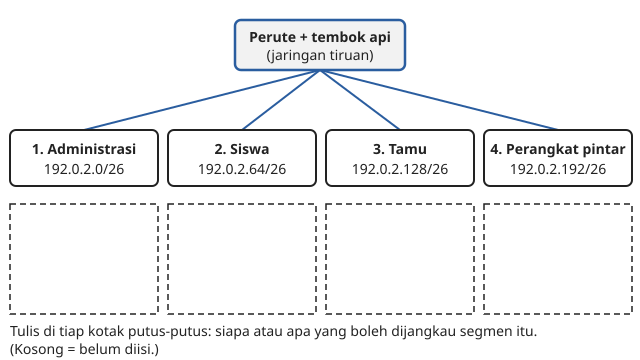

**Ingat dulu:** Tutup catatanmu dan tulis jawaban singkat.

1. Apa fungsi router dan switch?
2. Apa arti hak akses minimum?



`[Gambar: perute dan tembok api di tengah, terhubung ke empat segmen jaringan tiruan: 1 Administrasi (192.0.2.0/26), 2 Siswa (192.0.2.64/26), 3 Tamu (192.0.2.128/26), 4 Perangkat pintar (192.0.2.192/26). Di bawah tiap segmen ada kotak kosong bergaris putus-putus untuk menulis aturan akses.]`

**Prediksi:** Lihat konfigurasi perute fiktif ini. Tulis tiga risiko terbesar menurutmu, urut dari yang paling berbahaya.

```text
Nama jaringan   : Rumah-Pak-Contoh-Jl-Mawar-12
Enkripsi        : terbuka (tanpa kata sandi)
Akun admin      : admin / admin
Admin dari luar : aktif
Firmware        : belum pernah diperbarui
Tamu dan TV     : satu jaringan dengan komputer keluarga
```

Risiko 1: ______  Risiko 2: ______  Risiko 3: ______

**Lengkapi:** Rencana alamat tiruan. Awalan `/26` berarti ______ alamat per segmen (2 pangkat ____); satu alamat di awal dan satu di akhir dicadangkan, sehingga tersisa ______ alamat untuk perangkat.

| Segmen | Awalan | Pertahanan berlapis: lapis apa yang dijaga segmentasi? |
| --- | --- | --- |
| Administrasi | 192.0.2.0/26 | |
| Siswa | 192.0.2.64/26 | |
| Tamu | 192.0.2.128/26 | |

**Latihan:**

1. Isi kotak aturan akses pada gambar untuk keempat segmen. ______
2. Perute keluarga fiktif memakai nama pengguna dan kata sandi bawaan pabrik, enkripsi lama, dan firmware belum pernah diperbarui. Daftarkan lima perbaikan berurutan dan alasannya. ______
3. Tulis hak akses yang tepat untuk empat peran fiktif (guru, siswa, tamu, teknisi) pada jaringan sekolah tiruan, dan satu hak yang sengaja tidak diberikan kepada masing-masing. ______
4. Seorang tokoh fiktif ingin memakai Wi-Fi kafe untuk membuka akun penting. Tulis risikonya, apa yang dapat dibantu VPN, apa yang tidak, dan satu alternatif yang lebih aman. ______
5. Nilai dua pernyataan: "Dengan VPN, kantor kita pasti aman." dan "Dengan tembok api, karyawan yang membuka tautan palsu tetap aman." ______

**Cek diri:**

- [ ] Saya dapat menjelaskan pertahanan berlapis dengan contoh.
- [ ] Saya dapat menjelaskan segmentasi dan prinsip hak minimum.
- [ ] Saya dapat menjelaskan apa yang dapat dan tidak dapat dilakukan tembok api dan VPN.

**Catatan cetak (untuk guru, tidak dicetak):** satu lembar A4 (dua halaman bila ruang jawab diperlukan). Kunci ada di modul `pendamping-keamanan-lanjut-konektivitas` bagian "Petunjuk jawaban". Modul tidak punya soal susun, sehingga bagian itu dilewati. Lembar tidak memuat kolom nama, kelas, tanggal, atau nilai, dan hanya memakai jaringan tiruan.
