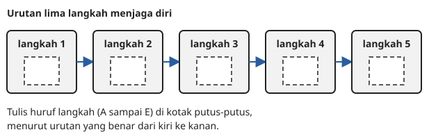

**Ingat dulu:** Tutup catatanmu dan tulis jawaban singkat.

1. Apa fungsi autentikasi dua langkah?
2. Sebutkan dua ciri pesan tipuan (*phishing*).

`[Gambar: lima kotak berurutan dari kiri ke kanan, berlabel langkah 1 sampai langkah 5, dihubungkan panah. Tiap kotak punya slot kosong bergaris putus-putus untuk menulis huruf langkah yang kamu pilih pada soal Susun.]`

**Lengkapi:** Tiap pesan fiktif berikut berasal dari jenis konten yang berbeda. Tulis jenisnya dan langkah pertama yang kamu lakukan.

| Pesan fiktif | Jenis | Langkah pertama |
| --- | --- | --- |
| "Kalau kamu tidak ikut, kami keluarkan kamu dari grup selamanya." | | |
| "Modal 50 ribu jadi 5 juta dalam sehari, daftar lewat tautan ini." | | |
| "Kelompok X semuanya jahat, usir mereka." | | |
| "Aku kakak kelas di permainan, kirim fotomu ya, jangan bilang orang tua." | | |

**Susun:** Lima langkah menjaga diri berikut tercampur. Susun menjadi urutan yang benar memakai kotak pada gambar.

- A. Blokir dan atur: blokir akun, matikan komentar, atur siapa yang boleh menghubungimu.
- B. Cerita: bicaralah dengan orang yang kamu percaya.
- C. Berhenti: jangan membalas, jangan membuka tautan, jangan meneruskan.
- D. Lapor: pakai fitur pelaporan di platform dan beri tahu orang dewasa yang dipercaya.
- E. Simpan bukti seperlunya, dengan data pribadi ditutup.

Urutanku: ______ , ______ , ______ , ______ , ______

**Latihan:**

1. Akun fiktif "@bintang_contoh" menulis di komentar foto kelas fiktif: "Kamu memang selalu paling lambat, sebaiknya tidak usah ikut." Murid fiktif "Murid-07" merasa sedih. Tulis (a) jenis konten apa ini, (b) tiga langkah yang dapat dilakukan Murid-07, (c) satu hal yang dapat dilakukan teman sekelas. ______
2. Pesan fiktif: "Selamat! Kamu terpilih menang hadiah. Klik tautan dan masukkan kode verifikasi yang baru kamu terima agar hadiah dikirim." Tulis tanda peringatan yang kamu temukan dan apa yang kamu lakukan. ______
3. Orang asing fiktif di permainan daring menulis: "Kirim foto kamu dan jangan bilang siapa-siapa." Tulis apa yang kamu lakukan lebih dahulu dan kepada siapa kamu bercerita. ______
4. Apa yang kamu lakukan bila temanmu menjadi sasaran, dan apa yang tidak kamu lakukan? ______

**Cek diri:**

- [ ] Saya hafal langkah berhenti, simpan, lapor, blokir, cerita.
- [ ] Saya tahu siapa orang dewasa yang dapat saya ajak bicara.
- [ ] Saya tahu bahwa korban tidak bersalah.

**Catatan cetak (untuk guru, tidak dicetak):** satu lembar A4 (satu halaman). Kunci ada di modul `pendamping-menyaring-konten-negatif` bagian "Petunjuk jawaban" dan "Latihan bercampur". Lembar hanya memakai kasus fiktif dan tidak meminta siswa mencari contoh sungguhan. Lembar tidak memuat kolom nama, kelas, tanggal, atau nilai. Cantumkan kontak bantuan resmi setempat pada lembar terpisah yang dicek sekolah.
