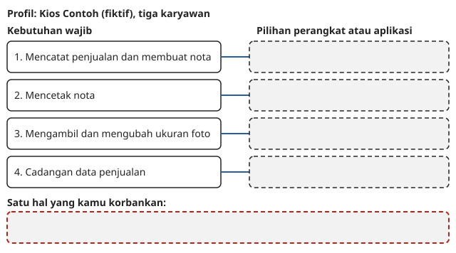

**Ingat dulu:** Tutup catatanmu dan tulis jawaban singkat.

1. Apa beda memori dan penyimpanan?
2. Sebutkan tiga tahap siklus input-proses-output.

`[Gambar: empat kebutuhan wajib "Kios Contoh" di kiri: mencatat penjualan dan membuat nota, mencetak nota, mengambil dan mengubah ukuran foto, cadangan data penjualan. Tiap kebutuhan dihubungkan garis ke kotak kosong di kanan untuk pilihan perangkat atau aplikasi. Di bawah ada satu kotak kosong untuk hal yang kamu korbankan.]`

**Prediksi:** "Kios Contoh" fiktif punya tiga karyawan dan anggaran untuk dua perangkat dan satu pencetak. Isi kotak pilihan pada gambar untuk tiap kebutuhan wajib, dan tulis satu hal yang kamu korbankan di kotak bawah.

**Lengkapi:** Tentukan tiap kalimat fiktif sebagai kebutuhan (sebutkan jenisnya) atau spesifikasi, dan tulis ulang yang kabur.

| Kalimat | Kebutuhan (jenis) atau spesifikasi? | Tulis ulang bila kabur |
| --- | --- | --- |
| "Laptop menyala sampai 8 jam tanpa pengisian." | | |
| "Beli laptop dengan memori besar." | | |
| "Data klien tidak boleh hilang." | | |
| "Pakai penyimpanan yang cepat." | | |
| "Komputer yang bagus." | | |
| "Dipakai di ruangan tanpa pendingin udara." | | |

**Susun:** Enam langkah dari kebutuhan ke spesifikasi berikut tercampur. Susun menjadi urutan yang benar.

- A. Bandingkan opsi dan tulis rekomendasi.
- B. Tulis kebutuhan dan beri prioritas.
- C. Periksa kembali apakah setiap kebutuhan wajib terpenuhi.
- D. Batasi: anggaran, ruang, daya listrik, kemampuan merawat.
- E. Kenali pengguna: siapa, tugas apa, di mana, berapa orang.
- F. Terjemahkan kebutuhan menjadi spesifikasi.

Urutanku: ______ , ______ , ______ , ______ , ______ , ______

**Latihan:**

1. "Perpustakaan Contoh" (fiktif) memerlukan satu komputer untuk mencatat peminjaman buku oleh banyak petugas bergantian dan satu pemindai kode batang. Tulis profil, minimal enam kebutuhan (tandai wajib atau diinginkan), dan rancangan spesifikasi. ______
2. Tulis ulang kebutuhan kabur "komputer cepat" menjadi kalimat yang dapat diperiksa (apa yang diukur, kondisinya, batasnya). ______
3. Tulis lima pertanyaan untuk menggali kebutuhan "Tokoh Contoh" (fiktif), yang akan belajar pemrograman, menggambar sketsa digital, dan sering membawa perangkat ke sekolah. Hanya menulis pertanyaan, tidak mewawancarai siapa pun. ______
4. Mengapa pilihan tanpa kebutuhan adalah pemborosan, dan kebutuhan tanpa pilihan adalah kekurangan? ______

**Cek diri:**

- [ ] Saya dapat membedakan kebutuhan dari spesifikasi.
- [ ] Saya dapat menautkan setiap pilihan perangkat ke satu kebutuhan.
- [ ] Saya dapat membandingkan dua opsi dan menyebut kompromi masing-masing.

**Catatan cetak (untuk guru, tidak dicetak):** satu lembar A4 (dua halaman bila ruang jawab diperlukan). Kunci ada di modul `pendamping-merancang-kebutuhan-sistem` bagian "Petunjuk jawaban" dan "Latihan bercampur". Lembar hanya memakai pengguna fiktif dan tidak memuat kolom nama, kelas, tanggal, atau nilai.
