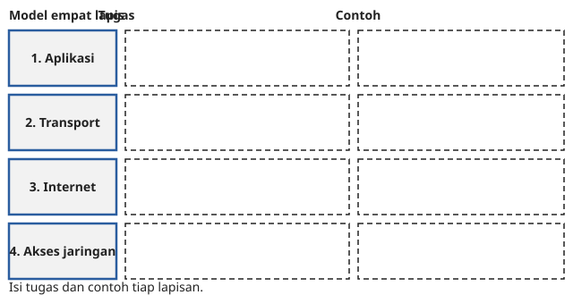

**Ingat dulu:** Tutup catatanmu dan tulis jawaban singkat.

1. Apa fungsi alamat IP dan apa fungsi DNS?
2. Urutkan diagnosis dasar dari yang pertama diperiksa sampai yang terakhir.

`[Gambar: empat lapisan bertumpuk dari atas ke bawah: 1 Aplikasi, 2 Transport, 3 Internet, 4 Akses jaringan. Tiap lapisan punya dua kotak kosong bergaris putus-putus di kanannya: satu untuk tugas lapisan dan satu untuk contoh.]`

**Prediksi:** Tulis dugaanmu. (1) Ping ke gerbang berhasil, ping ke alamat tujuan berhasil, tetapi nama tujuan tidak dapat diterjemahkan: bagian mana yang bermasalah (fisik, alamat IP, DNS, atau layanan)? (2) Ping ke gerbang gagal padahal alamat IP perangkatmu benar: apa dua dugaanmu? (3) Ping ke tujuan berhasil dan nama berhasil, tetapi layanan tidak tampil: apa dugaanmu? ______

**Lengkapi:** Untuk setiap kartu fiktif, tulis langkah diagnosis (1 sampai 6, dari fisik sampai layanan) dan dugaan penyebab.

| Kartu | Gejala | Hasil uji | Langkah | Dugaan penyebab |
| --- | --- | --- | --- | --- |
| A | "Tidak ada internet" | Lampu port padam | | |
| B | "Hanya satu komputer bermasalah" | Alamat IP perangkat berbeda jaringan dengan yang lain | | |
| C | "Bisa ping alamat IP, tidak bisa buka nama" | Penerjemahan nama gagal | | |
| D | "Situs lab lambat" | Server menerima banyak permintaan sekaligus | | |
| E | "Berkas tidak terkirim ke komputer lain" | Ping berhasil; layanan berbagi berkas belum berjalan | | |

**Susun:** Peristiwa saat peramban membuka `contoh.test` berikut tercampur. Susun menjadi urutan yang benar.

- A. router meneruskan paket ke jaringan tujuan
- B. peramban meminta DNS menerjemahkan `contoh.test`
- C. DNS membalas dengan alamat IP
- D. server menerima permintaan dan menjawab
- E. peramban membuat sambungan dan mengirim permintaan sebagai paket
- F. paket jawaban dikembalikan dan disusun di peramban

Urutanku: ______ , ______ , ______ , ______ , ______ , ______

**Latihan:**

1. Tiga komputer lab tersambung ke satu switch, dan tidak ada server pusat: dua komputer bertukar berkas langsung satu sama lain. Sebutkan topologi dan model jaringannya. ______
2. Kartu F: ping ke gerbang berhasil, ping ke komputer tujuan gagal padahal komputer itu menyala. Tulis langkah dan dugaan penyebab. ______
3. Kartu G: nama diterjemahkan, ping berhasil, tetapi peramban menampilkan "situs tidak dapat dijangkau". Tulis langkah dan dugaan. ______
4. Pada gambar, tulis lapisan (model empat lapis) tempat HTTP, TCP, alamat IP, dan kabel berada. ______

**Cek diri:**

- [ ] Saya dapat membedakan klien-server dan rekan sebaya.
- [ ] Saya hafal urutan diagnosis dari fisik sampai layanan.
- [ ] Saya tahu bahwa gagal ping bukan satu-satunya bukti masalah.

**Catatan cetak (untuk guru, tidak dicetak):** satu lembar A4 (dua halaman bila ruang jawab diperlukan). Kunci ada di modul `pendamping-model-jaringan-dan-troubleshooting` bagian "Petunjuk jawaban". Lembar hanya memakai kartu skenario fiktif, tanpa alamat atau kata sandi nyata, dan tidak memuat kolom nama, kelas, tanggal, atau nilai.
