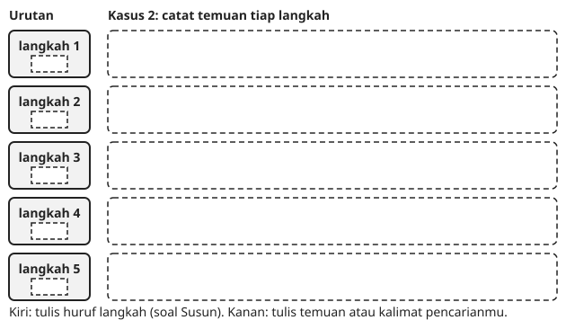

**Ingat dulu:** Tanpa membuka modul, jawab.

1. Apa beda fakta, opini, dan klaim belum terbukti?
2. Mengapa "belum cukup bukti" adalah jawaban yang sah?

**Prediksi:** Situs fiktif "Lembaga Kajian Air Bersih Nusantara Contoh" memuat artikel "Air sumur boleh diminum tanpa dimasak". Tampilannya rapi, ada logo, banyak grafik, dan tulisannya meyakinkan. Tulis: (1) seberapa yakin kamu bahwa artikel itu benar (0 sampai 10): ______ (2) apa saja yang kamu lakukan untuk memutuskan: ______

`[Gambar: lima baris. Tiap baris punya kotak kiri berlabel langkah 1 sampai 5 dengan slot huruf kosong, dan kotak kanan bergaris putus-putus untuk mencatat temuan atau kalimat pencarian pada Latihan nomor 2.]`

**Lengkapi:** Klasifikasikan tiap pernyataan fiktif sebagai fakta, opini, atau klaim belum terbukti, dan tulis satu langkah membaca lateral bila harus memutuskan percaya atau tidak.

| Pernyataan | Jenis | Langkah membaca lateral |
| --- | --- | --- |
| "Jembatan Desa Contoh sepanjang 40 meter." | | |
| "Jembatan Desa Contoh adalah yang terindah di kabupaten." | | |
| "Katanya jembatan itu akan dirobohkan bulan depan." | | |
| "Menurut laporan tahunan dinas fiktif, jembatan itu diperiksa dua kali setahun." | | |
| Unggahan akun baru: "Jembatan itu retak, tolong sebarkan sebelum terlambat!" | | |

**Susun:** Lima langkah membaca lateral berikut tercampur. Susun menjadi urutan yang benar memakai slot pada gambar.

- A. Putuskan: benar, salah, atau belum cukup bukti.
- B. Cari klaimnya dengan kata kunci sendiri; adakah sumber independen atau hasil periksa fakta?
- C. Tanyakan siapa di balik informasi ini dan catat nama situs atau akunnya.
- D. Telusuri ke sumber asli, misalnya dokumen data yang dikutip.
- E. Buka tab baru dan cari nama itu bersama kata seperti "profil" atau "ulasan".

Urutanku: ______ , ______ , ______ , ______ , ______

**Latihan:**

1. Pesan berantai fiktif: "Air Sumur Kampung Rimbun dinyatakan beracun! Semua warga wajib berhenti minum mulai hari ini. Sebarkan!" Tulis (a) klaim yang dapat dicek, (b) bagian yang hanya mengajak bertindak atau menakut-nakuti, (c) tiga hal yang perlu dicari untuk membuktikannya. ______
2. Situs fiktif "Institut Riset Sehat Mandiri Nusantara" menayangkan artikel "Minum tiga liter kopi sehari menyembuhkan semua penyakit". Bayangkan pencarianmu menemukan: (i) situs baru dibuat dua bulan lalu, (ii) pemiliknya menjual suplemen di halaman lain, (iii) tidak ada tenaga kesehatan yang menyebutnya. Tulis kesimpulan dan alasanmu, lalu tiga kalimat pencarian yang akan kamu ketik bila situs semacam itu sungguh ada (catat di kotak kanan gambar). ______
3. Unggahan fiktif akun "@kabar_kilat_contoh": "Kata ahli, sekolah akan libur sebulan." Tidak ada nama ahli, tanggal, atau tautan. Tulis pertanyaan yang kamu ajukan sebelum percaya, dan siapa yang paling tepat ditanya. ______
4. Dua pembaca fiktif membaca artikel air sumur di situs lembaga fiktif. A tetap di halaman itu dan menilai tampilannya; B membuka tab baru dan mencari nama lembaga bersama "profil" dan "ulasan". Beri nama pola yang membedakan keduanya. ______

**Cek diri:**

- [ ] Saya dapat membedakan fakta, opini, dan klaim belum terbukti pada contoh baru.
- [ ] Saya dapat menuliskan urutan langkah membaca lateral dengan kata-kata sendiri.
- [ ] Saya menunda membagikan informasi yang belum saya cek.

**Catatan cetak (untuk guru, tidak dicetak):** satu lembar A4 (dua halaman bila ruang jawab diperlukan). Kunci ada di modul `pendamping-periksa-fakta-dan-baca-lateral` bagian "Petunjuk jawaban" dan "Latihan bercampur". Seluruh kasus fiktif; lembar tidak memuat kolom nama, kelas, tanggal, atau nilai.
