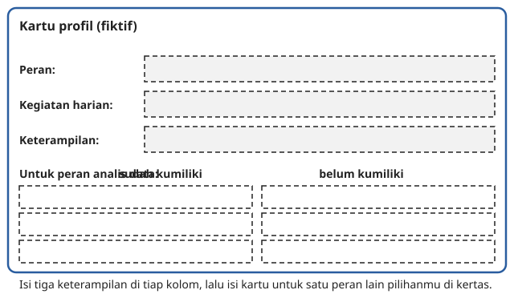

**Ingat dulu:** Tanpa membuka modul, jawab.

1. Apa digitalisasi budaya dan tiga hal yang perlu dijaga?
2. Mengapa izin dan atribusi komunitas penting walau mendigitalkan itu niat baik?

`[Gambar: kartu dengan tiga baris isian kosong (peran, kegiatan harian, keterampilan). Di bawahnya dua kolom, "sudah kumiliki" dan "belum kumiliki", masing-masing tiga kotak kosong untuk keterampilan peran analis data.]`

**Lengkapi:** Rancangan pelestarian satu unsur budaya dari pengetahuan umum (misalnya permainan tradisional yang aturannya sudah diketahui luas).

| Pertanyaan | Jawabanmu |
| --- | --- |
| Unsur budaya apa dan dari komunitas mana? | |
| Apa yang akan didokumentasikan (teks, foto, rekaman, aksara)? | |
| Siapa yang perlu dimintai izin atau dilibatkan? | |
| Teknologi apa yang dipakai dan mengapa? | |
| Bagaimana arsip disimpan dan dicadangkan? | |
| Bagaimana sumber dan pencipta dicantumkan? | |

**Latihan:**

1. Kartu profil fiktif: "Peran: analis data. Kegiatan harian: merapikan tabel penjualan toko fiktif, membuat grafik, menyampaikan temuan ke pemilik toko. Keterampilan: lembar kerja, statistik dasar, menulis ringkas." Isi kartu pada gambar: tiga keterampilan yang sudah kamu miliki dan tiga yang belum. ______
2. Tulis satu kegiatan belajar yang bisa kamu mulai bulan ini untuk peran itu (misalnya proyek kecil dengan data sintetis). ______
3. Pilih satu peran lain dari tabel profesi di modul dan buat kartu profilnya sendiri dengan format yang sama. Jangan menuliskan data pribadi orang lain. ______
4. Dua proyek fiktif ingin mendigitalkan naskah "Hikayat Contoh". Proyek A meminta izin pemilik dan tetua komunitas, memindai dengan resolusi baik, menyimpan dua salinan, dan mencantumkan pemilik. Proyek B meminjam diam-diam, memotret sekilas, menyimpan satu berkas, dan menayangkannya sebagai "karya kami". Apa tujuan yang sama keduanya, dan beri nama untuk perbedaan pokoknya. ______
5. Sebutkan lima peran bidang Informatika dan satu tugas utama masing-masing. ______

**Cek diri:**

- [ ] Saya tahu bahwa keterampilan lunak juga dibutuhkan.
- [ ] Saya punya satu langkah belajar yang nyata untuk peran yang saya minati.
- [ ] Saya tahu bahwa izin dan atribusi komunitas perlu diperhatikan.

**Catatan cetak (untuk guru, tidak dicetak):** satu lembar A4 (dua halaman bila ruang jawab diperlukan). Kunci ada di modul `pendamping-profesi-informatika-dan-budaya-digital` bagian "Petunjuk jawaban". Modul tidak punya materi urutan atau prediksi, sehingga bagian Prediksi dan Susun dilewati. Lembar hanya memakai kasus fiktif dan tidak memuat kolom nama, kelas, tanggal, atau nilai.
