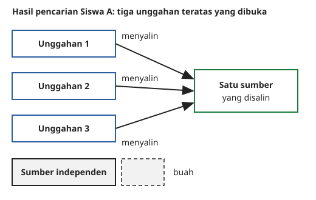

**Ingat dulu:** Tutup catatanmu dan tulis jawaban singkat.

1. Apa beda fakta, opini, dan klaim belum terbukti? ______
2. Apa beda membaca vertikal dan membaca lateral? ______
3. Mengapa "belum cukup bukti" adalah kesimpulan yang sah? ______

`[Gambar: diagram dengan tiga kotak Unggahan 1, Unggahan 2, dan Unggahan 3 di kiri. Dari tiap kotak ada panah berlabel menyalin ke satu kotak Satu sumber yang disalin di kanan. Di bawahnya kotak kosong untuk menulis banyaknya sumber independen. Kamu mengisinya pada soal Latihan 1.]`

**Lengkapi:** Teknik pencarian umum. Tulis fungsi tiap teknik.

| Teknik | Contoh bentuk | Fungsi |
| --- | --- | --- |
| Frasa persis | `"kata yang persis"` | |
| Mengecualikan kata | tanda minus di depan kata | |
| Membatasi situs | `site:` diikuti nama situs | |
| Jenis berkas | `filetype:` diikuti jenis berkas | |
| Saringan waktu | menu alat pencarian | |

**Latihan:** Semua bahan fiktif.

1. Siswa A mencari "apakah kecelakaan di Kota Contoh naik?" dengan kata kunci `kecelakaan kota contoh naik`, lalu membuka tiga unggahan teratas yang saling mengutip dan tidak mencatat apa pun. Siswa B memakai `"kecelakaan lalu lintas" "Kota Contoh" data tahunan site:dinas.contoh.example` dengan saringan waktu setahun terakhir, membuka dokumen data asli dan satu berita, dan mencatat kata kunci serta sumbernya. (a) Apa yang berbeda dalam kualitas pertanyaan, teknik pencarian, dan jenis sumber? (b) Bila ketiga unggahan yang dibuka A menyalin satu sumber, berapa sumber independen yang ia punya? Tulis jawabanmu pada gambar. ______
2. Foto: antrean panjang di depan toko dengan keterangan "Kelangkaan hari ini". Tulis jenis bahannya, dua langkah pertama yang kamu lakukan, dan kesimpulan sementara yang paling jujur. ______
3. Angka: "Pengguna aplikasi naik 500 persen." Tulis jenis bahannya, dua langkah pertama, dan kesimpulan sementara yang paling jujur. ______
4. Jawaban asisten AI: "Menurut studi Universitas Contoh 2021, 80 persen siswa lebih suka belajar daring." Tulis jenis bahannya, dua langkah pertama, dan kesimpulan sementara yang paling jujur. ______

**Cek diri:**

- [ ] Saya dapat memakai frasa persis, pembatasan situs, dan saringan waktu.
- [ ] Saya tahu langkah memverifikasi teks, gambar, dan video.
- [ ] Saya dapat memecah informasi kompleks menjadi klaim kecil.

**Catatan cetak (untuk guru, tidak dicetak):** satu lembar A4 (satu halaman, bisa dua sisi bila ruang jawab diperbesar). Kunci ada di modul `pendamping-riset-dan-verifikasi-konten` bagian "Petunjuk jawaban". Lembar tidak memuat kolom nama, kelas, tanggal, atau nilai.
