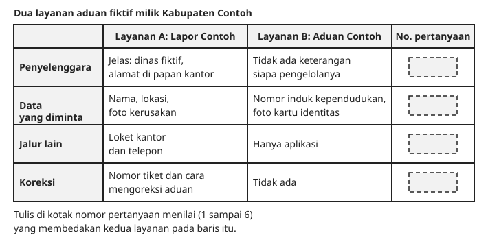

**Ingat dulu:** Tutup catatanmu dan tulis jawaban singkat.

1. Apa prinsip yang sama untuk memverifikasi teks, gambar, dan video? ______
2. Mengapa lima unggahan yang menyalin satu sumber dihitung sebagai satu sumber? ______
3. Mengapa jawaban asisten AI diperlakukan sebagai klaim, bukan sumber? ______

`[Gambar: tabel empat baris, yaitu Penyelenggara, Data yang diminta, Jalur lain, dan Koreksi, untuk Layanan A Lapor Contoh dan Layanan B Aduan Contoh. Kolom terakhir berisi kotak kosong untuk nomor pertanyaan menilai. Kamu mengisinya pada soal Latihan 1.]`

**Lengkapi:** Tulis risiko tiap bidang pemanfaatan teknologi dalam demokrasi.

| Bidang | Contoh pemanfaatan | Manfaat | Risiko |
| --- | --- | --- | --- |
| Akses informasi publik | situs resmi dengan dokumen anggaran dan data terbuka | transparansi; dapat diperiksa warga | |
| Partisipasi | kanal aduan daring, konsultasi rancangan kebijakan | suara lebih mudah sampai | |
| Layanan publik daring | pengurusan dokumen, pembayaran, pelaporan | cepat dan lebih mudah diawasi | |

Enam pertanyaan menilai layanan atau kampanye digital: (1) Siapa penyelenggaranya, dan apakah jelas? (2) Data apa yang diminta, dan apakah perlu? (3) Apakah ada cara lain bagi yang tidak memakai internet? (4) Apakah informasinya dapat diperiksa ke sumber asli? (5) Apakah ada mekanisme koreksi atau pengaduan? (6) Siapa yang mungkin tertinggal atau dirugikan?

**Latihan:** Semua skenario fiktif; "Kabupaten Contoh" tidak ada.

1. Pada gambar, tulis nomor pertanyaan menilai yang membedakan kedua layanan pada tiap baris. Siapa yang mungkin tertinggal atau dirugikan pada Layanan B? ______
2. Akun fiktif menyebarkan pesan: "Semua warga Kabupaten Contoh wajib mendaftar di tautan ini sebelum akhir pekan atau bantuan hangus." Tautan memakai alamat yang tidak mirip situs resmi. Tulis tanda peringatan dan langkah memeriksanya. ______
3. Di forum daring, pembahasan fiktif tentang rancangan peraturan desa memuat banyak komentar sama persis dari akun berbeda yang baru dibuat. Apa yang kamu curigai dan bagaimana kamu menilai suara warga yang sebenarnya? ______
4. Kabupaten Contoh membuka konsultasi daring: "Setuju atau tidak? Isi formulir di tautan ini, wajib memakai nomor induk kependudukan, sebelum Jumat!" Tulis tiga pertanyaan menilai yang kamu ajukan pada formulir itu. ______

**Cek diri:**

- [ ] Saya dapat memberi tiga contoh pemanfaatan teknologi dalam demokrasi.
- [ ] Saya dapat memakai enam pertanyaan untuk menilai layanan digital.
- [ ] Saya memeriksa sebelum membagikan dan menghormati perbedaan pendapat.

**Catatan cetak (untuk guru, tidak dicetak):** satu lembar A4 (satu halaman, bisa dua sisi bila ruang jawab diperbesar). Kunci ada di modul `pendamping-teknologi-dan-demokrasi` bagian "Petunjuk jawaban". Lembar tidak memuat kolom nama, kelas, tanggal, atau nilai.
