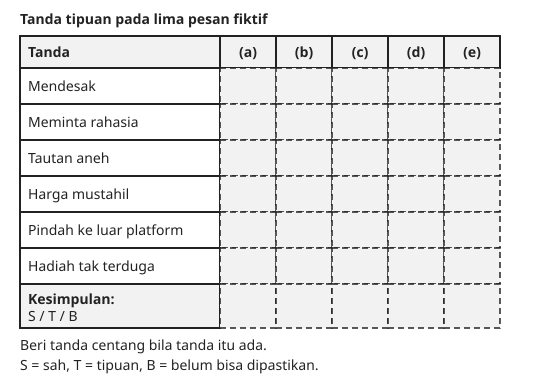

**Ingat dulu:** Tutup catatanmu dan tulis jawaban singkat.

1. Apa fungsi autentikasi dua langkah? ______
2. Sebutkan dua ciri pesan tipuan (*phishing*). ______
3. Apa yang tidak boleh ditempel ke layanan AI? ______

`[Gambar: tabel dengan enam baris tanda tipuan (Mendesak, Meminta rahasia, Tautan aneh, Harga mustahil, Pindah ke luar platform, Hadiah tak terduga) dan lima kolom berlabel (a) sampai (e) untuk lima pesan pada soal Latihan 1. Semua sel kosong; baris terakhir Kesimpulan diisi S, T, atau B.]`

**Prediksi:** Lihat dua notifikasi fiktif. Tebak mana yang tipuan dan mengapa. ______

- Notifikasi 1: "Dompet Contoh: pembayaran Rp25.000 di Toko Contoh berhasil. Bukan kamu? Buka aplikasi Dompet Contoh dan pilih Bantuan."
- Notifikasi 2: "Dompet Contoh: akunmu dibatasi dalam 1 jam. Klik tautan dan masukkan PIN untuk memulihkan."

**Lengkapi:** Tulis hal yang perlu diwaspadai pada tiap layanan.

| Layanan | Fungsi | Hal yang perlu diwaspadai |
| --- | --- | --- |
| Loka pasar | tempat penjual dan pembeli bertransaksi barang atau jasa | |
| Perbankan digital | mengelola rekening lewat aplikasi atau situs bank | |
| Dompet digital | menyimpan saldo dan membayar lewat aplikasi | |

**Susun:** Saldo berkurang tanpa kamu tahu. Susun lima langkah menjadi urutan yang masuk akal.

- A. simpan bukti
- B. berhenti bertransaksi
- C. beri tahu orang tua atau wali dan guru, dan laporkan lewat kanal resmi
- D. ganti kata sandi dan keluarkan perangkat lain
- E. hubungi penyedia lewat kanal resmi untuk memblokir

Urutanku: ______ , ______ , ______ , ______ , ______

**Latihan:** Semua pesan fiktif. Tulis: sah, tipuan, atau belum bisa dipastikan; tandanya; dan tindakanmu. Tandai juga pada gambar.

1. (a) "Dompet Contoh: pembayaran Rp18.000 ke Warung Contoh berhasil. Cek riwayat di aplikasi." (kamu memang baru membayar di warung itu) ______
2. (b) Sesudah kamu masuk ke aplikasi Bank Contoh: "Kode verifikasi Bank Contoh: 000000. Jangan berikan kepada siapa pun, termasuk petugas." ______
3. (c) Telepon: "Petugas Bank Contoh di sini. Ada transaksi mencurigakan; sebutkan kode yang baru dikirim agar kami batalkan." ______
4. (d) Penjual di Loka Pasar Contoh: "Ponsel baru sepersepuluh harga, transfer ke rekening pribadi saya, jangan lewat platform." ______
5. (e) "Loka Pasar Contoh: pesananmu dikirim, estimasi tiba Kamis. Lacak di aplikasi." (kamu memang memesan) ______
6. Halaman toko fiktif "TokoMurahContoh" menjual sepatu jauh di bawah harga pasar; akunnya baru dibuat tiga hari lalu, tidak ada ulasan, dan pemilik meminta pembayaran lewat pesan langsung. Tulis tanda peringatan dan apa yang kamu lakukan. ______

**Cek diri:**

- [ ] Saya tahu bahwa OTP, PIN, dan kata sandi tidak diberikan kepada siapa pun.
- [ ] Saya dapat menyebut lima tanda tipuan.
- [ ] Saya tahu tiga langkah pertama bila terkena penipuan.

**Catatan cetak (untuk guru, tidak dicetak):** satu lembar A4 (satu halaman, bisa dua sisi bila ruang jawab diperbesar). Kunci ada di modul `pendamping-transaksi-digital-aman` bagian "Petunjuk jawaban". Lembar tidak memuat kolom nama, kelas, tanggal, atau nilai.
