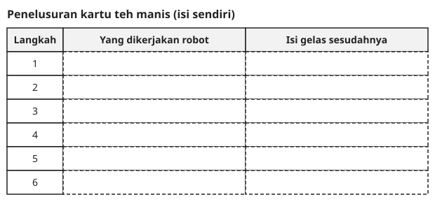

**Ingat dulu:** Tanpa melihat modul dan tanpa bertanya siapa pun, tulis langkah-langkah mencuci tangan sebelum makan sebanyak yang kamu ingat. Waktumu lima menit.

______

`[Gambar: tabel dengan tiga kolom (Langkah, Yang dikerjakan robot, Isi gelas sesudahnya) dan enam baris bernomor 1 sampai 6. Kolom kedua dan ketiga kosong; isi tabel ini saat temanmu menjalankan kartu teh di bagian Prediksi.]`

**Prediksi:** Kartu "membuat teh manis": 1 Ambil gelas. 2 Masukkan teh. 3 Tuang air. 4 Aduk. 5 Beri gula. 6 Minum. Temanmu menjadi robot yang hanya mengerjakan persis kata di kartu. Di mejanya ada gelas kosong, kantong teh, ketel berisi air, toples gula, dan sendok.

(a) Isi gelas setelah langkah 6: ______

(b) Tiga langkah yang bisa membuat robot bingung, dan mengapa: ______

Sesudah temanmu menjalankan kartu, isi tabel pada gambar, lalu lingkari langkah yang dikerjakan dengan cara yang tidak kamu maksud.

**Lengkapi:** Kartu "mencuci tangan" ini punya lubang. Isi dengan kata yang tepat.

1. Gulung lengan baju sampai ______.
2. Basahi kedua tangan dengan air mengalir.
3. Ambil sabun secukupnya. Kata "secukupnya" kabur; gantilah dengan ______.
4. Gosok telapak, punggung tangan, dan ______ selama ______ detik.
5. Bilas sampai tidak ada busa.
6. Keringkan dengan ______.

**Susun:** Kartu berikut diacak. Susun menjadi instruksi "menyiapkan tas untuk besok" yang tepat.

- **A.** Masukkan buku sesuai jadwal ke dalam tas.
- **B.** Lihat jadwal pelajaran besok.
- **C.** Tutup dan kancingkan tas.
- **D.** Letakkan tas di dekat pintu.
- **E.** Keluarkan buku hari ini dari tas.
- **F.** Periksa bahwa buku PR sudah ada di dalam tas.

Urutanku: ______ , ______ , ______ , ______ , ______ , ______

Alasan urutanku aman: ______

**Latihan:**

1. Ubah: ambil tiga langkah yang kamu lingkari pada tabel, lalu tulis ulang agar robot tidak lagi salah. ______
2. Uji: tukar kartumu dengan teman dan jadilah robot untuk kartunya. Langkah yang membuatmu bingung: ______
3. Buat: pilih satu tugas (memakai sepatu, mengisi botol minum, atau menyalakan lampu kelas) dan tulis kartu 6 sampai 8 langkah yang tepat. ______
4. Jelaskan dengan dua kalimat mengapa kartu untuk robot harus lebih tepat daripada kartu untuk teman sekelas. ______

**Cek diri:**

- [ ] Aku bisa menyebut tiga kebiasaan kartu instruksi yang tepat.
- [ ] Aku bisa menjelaskan mengapa "Tuang air." kurang tepat.
- [ ] Aku bisa menunjuk langkah yang bisa salah dimengerti dan memperbaikinya.

**Catatan cetak (untuk guru, tidak dicetak):** satu lembar A4, satu halaman. Kunci ada di modul `SMP7-1-M1`, bagian "Contoh terselesaikan", "Catatan untuk guru", dan "Cek mandiri". Lembar tidak memuat kolom nama, kelas, tanggal, atau nilai.
