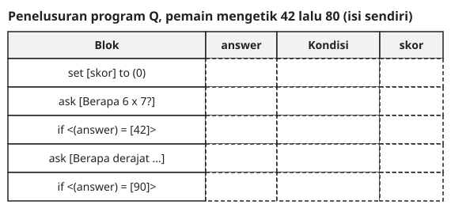

**Ingat dulu:** Tanpa melihat modul:

1. Pecah program kuis menjadi bagian kecil sebelum menulis blok, dan sebutkan bagian-bagiannya. ______
2. Apa beda `set` dan `change` pada variabel? ______
3. Apa yang dijalankan `if ... else` bila kondisinya benar, dan apa bila salah? ______



`[Gambar: tabel dengan kolom Blok, answer, Kondisi, dan skor. Lima baris: set skor ke 0, ask "Berapa 6 x 7?", if answer = 42, ask "Berapa derajat ...", if answer = 90. Kolom answer, Kondisi, dan skor kosong; isi dengan anggapan pemain mengetik 42 lalu 80.]`

**Prediksi:** `ask [pertanyaan] and wait` menunggu pemain mengetik jawaban, yang disimpan di `(answer)`. Setiap `ask` baru menimpa isi `answer` yang lama. Program Q (pemain mengetik **42** lalu **80**):

```text
when green flag clicked
set [skor] to (0)
ask [Berapa 6 x 7?] and wait
if <(answer) = [42]> then
  change [skor] by (1)
ask [Berapa derajat sprite diputar tiap sudut persegi?] and wait
if <(answer) = [90]> then
  change [skor] by (1)
say (join [Skor: ] (skor)) for (2) seconds
```

Yang diucapkan sprite pada akhirnya: ______

Telusuri Q dan isi tabel pada gambar. Berapa isi `answer` sesudah `ask` kedua? ______

**Lengkapi:** Soal ketiga. Isi bagian kosong, lalu telusuri bila pemain menjawab 5.

```text setengah-jadi
ask [Berapa 9 - 4?] and wait
if <(answer) = [______]> then
  change [skor] by (______)
```

`skor` sesudah soal ketiga bila dua soal sebelumnya sudah benar: ______

**Susun:** Enam baris berikut diacak. Susun menjadi kuis satu soal yang mengucapkan skor.

- **A.** `set [skor] to (0)`
- **B.** `ask [Berapa 9 - 4?] and wait`
- **C.** `if <(answer) = [5]> then`
- **D.** `change [skor] by (1)` (di dalam `then`)
- **E.** `say (join [Skor: ] (skor)) for (2) seconds`
- **F.** `when green flag clicked`

Urutanku: ______ , ______ , ______ , ______ , ______ , ______

Mengapa `ask` harus sebelum `if`? ______

**Latihan:**

1. Pada program Q, ubah tambahan skor tiap jawaban benar menjadi 2. Berapa skor bila jawaban 42 dan 90? ______
2. Tulis kuis tiga soal dengan pertanyaan pilihanmu (tanpa nama orang nyata), lalu telusuri dengan satu rangkaian jawaban.
3. Tambahkan `else` yang membuat sprite mengucap "Salah" untuk soal pertama. ______
4. Jawaban pemain 5. Program: `if <(answer) > (3)> then say [Besar] else say [Kecil]`. Yang diucapkan: ______

**Cek diri:**

- [ ] Aku bisa menyebut apa yang disimpan `(answer)`.
- [ ] Aku bisa menelusuri kuis dan skornya.
- [ ] Aku bisa memecah kuis menjadi bagian kecil.

**Catatan cetak (untuk guru, tidak dicetak):** satu lembar A4, dua halaman. Kunci ada di modul `SMP7-1-M10`, bagian "Contoh terselesaikan" dan "Cek mandiri". Lembar tidak memuat kolom nama, kelas, tanggal, atau nilai.
