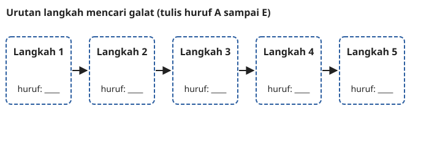

**Ingat dulu:** Tanpa melihat modul:

1. Program `repeat (5)` berisi `move (50) steps` dan `turn right (60) degrees` seharusnya menggambar segi lima beraturan. Aturan sudut mana yang kamu pakai, dan angka berapa yang benar? ______
2. Mengapa `if <(answer) = [...]>` harus tepat sesudah `ask` soalnya? ______
3. Apa beda `set` dan `change`? ______



`[Gambar: lima kotak kosong bernomor Langkah 1 sampai Langkah 5, dihubungkan panah dari kiri ke kanan, masing-masing dengan isian "huruf: ____". Dipakai pada bagian Susun untuk menulis huruf langkah.]`

**Prediksi:** Maksudmu: menggambar persegi sisi 80 dari (0, 0) menghadap kanan. Program R:

```text
when green flag clicked
go to x: (0) y: (0)
point in direction (90)
pen down
repeat (3)
  move (80) steps
  turn right (90) degrees
pen up
```

Apakah gambarnya persegi? ______ Di mana sprite berhenti? ______

Telusuri R dengan tabel ini, lalu tulis pada baris mana hasilnya mulai berbeda dari yang kamu mau.

| Putaran ke- | x setelah `move` | y setelah `move` | Arah setelah `turn` |
| --- | --- | --- | --- |
| 1 | | | |
| 2 | | | |
| 3 | | | |

Mulai berbeda pada: ______

**Lengkapi:** Program T seharusnya menambah skor bila pemain mengetik 42, tetapi skor selalu 0 pada permainan pertama.

```text
when green flag clicked
set [skor] to (0)
if <(answer) = [42]> then
  change [skor] by (1)
ask [Berapa 6 x 7?] and wait
say (skor) for (2) seconds
```

| Langkah | Isi catatan |
| --- | --- |
| Gejala | Skor selalu 0 walau pemain mengetik 42. |
| Telusuri | `if` diperiksa saat `answer` masih ______ karena belum ada `ask`. |
| Penyebab | ______ |
| Perbaikan | ______ |
| Aturan umum | ______ |

**Susun:** Lima langkah mencari galat berikut diacak. Tulis huruf pada kotak di gambar menurut urutan yang masuk akal.

- **A.** Jalankan program dan catat hasil sebenarnya.
- **B.** Ubah satu hal saja.
- **C.** Bandingkan dengan hasil yang kamu harapkan.
- **D.** Jalankan lagi dan bandingkan hasilnya.
- **E.** Telusuri blok demi blok sampai baris pertama tempat hasil mulai berbeda.

Mengapa mengubah banyak hal sekaligus menyulitkan pencarian? ______

**Latihan:**

1. Program `repeat (3)` berisi `move (90) steps` dan `turn right (60) degrees` seharusnya segitiga sama sisi. Tulis catatan penyebab dan aturan umumnya. ______
2. Program: `set [nyawa] to (3)`, `repeat (3)` berisi `change [nyawa] by (1)`, lalu `say (nyawa)`. Seharusnya nyawa berkurang satu tiap putaran sehingga berakhir 0. Tulis catatan penyebab. ______
3. Tulis program kecil dengan satu kesalahan sengaja, tukar dengan teman, dan cari kesalahan temanmu dengan langkah di atas.
4. Dengan dua kalimat, jelaskan mengapa menelusuri lebih berguna daripada menebak. ______

**Cek diri:**

- [ ] Aku bisa menyebut arti debugging dan langkah pertamanya.
- [ ] Aku bisa menjelaskan mengapa `set [skor] to (0)` tidak boleh di dalam `repeat` yang menambah skor.
- [ ] Aku bisa menulis catatan penyebab.

**Catatan cetak (untuk guru, tidak dicetak):** satu lembar A4, dua halaman. Kunci ada di modul `SMP7-1-M11`, bagian "Contoh terselesaikan", "Susun urutannya", dan "Cek mandiri". Lembar tidak memuat kolom nama, kelas, tanggal, atau nilai.
