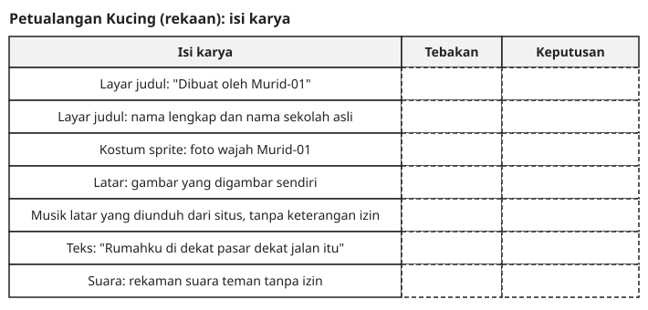

**Ingat dulu:** Tanpa melihat modul:

1. Tulis lima langkah mencari kesalahan dari menjalankan sampai uji ulang. ______
2. Sebutkan tiga bagian besar sebuah kuis di Scratch. ______
3. Apa beda `set` dan `change`? ______

`[Gambar: tabel tiga kolom Isi karya, Tebakan, dan Keputusan. Tujuh baris karya rekaan Murid-01: layar judul dengan nama samaran, layar judul dengan nama lengkap dan nama sekolah asli, foto wajah sebagai kostum, latar gambar sendiri, musik latar tanpa keterangan izin, teks tentang letak rumah, dan rekaman suara teman tanpa izin. Kolom Tebakan dan Keputusan kosong.]`

**Prediksi:** Aturan kelas untuk berbagi karya: **tanpa nama lengkap, tanpa wajah, tanpa lokasi**. Bahan milik orang lain hanya dipakai bila ada izinnya, dan pembuatnya dicantumkan.

Sebelum membaca aturan lebih jauh, tulis tebakanmu (aman dibagikan, atau tidak) pada kolom Tebakan di gambar. Lalu terapkan aturan kelas pada tiap baris dan isi kolom Keputusan. Baris mana yang membuatmu ragu, dan mengapa? ______

**Lengkapi:** Kartu aturan berbagi untuk kelasmu. Tiga baris pertama sudah ada; tulis tiga baris sisanya dengan kalimatmu sendiri.

1. Karya hanya memuat nama samaran, bukan nama lengkap.
2. Tidak ada wajah atau foto orang di karya.
3. Tidak ada tempat tinggal, nama sekolah asli, atau lokasi lain.
4. Bahan orang lain: ______
5. Rekaman suara atau gambar teman: ______
6. Sebelum membagikan, aku ______

**Latihan:**

1. Ubah dua baris pada tabel "Isi karya" supaya semuanya aman, dan tulis perubahannya. ______
2. Tulis kartu aturan berbagi dengan lima aturan. Setiap aturan satu kalimat jelas.
3. Buat kartu atribusi untuk satu bahan rekaan: judul, pembuat samaran, izin, tautan `.example`, ada perubahan atau tidak. ______
4. Program: `when green flag clicked`, `say [Aku Murid-01 dari SMP Contoh di Jalan Rekaan] for (2) seconds`. Baris mana yang melanggar aturan kelas, dan tulis ulang agar aman. ______
5. Dengan dua kalimat, jelaskan mengapa foto yang sudah dibagikan sulit ditarik kembali. ______

**Cek diri:**

- [ ] Aku bisa menyebut tiga hal yang tidak boleh ada di karya yang dibagikan.
- [ ] Aku bisa menyebut isi kartu atribusi.
- [ ] Aku bisa menjelaskan arti rekam jejak digital.

**Catatan cetak (untuk guru, tidak dicetak):** satu lembar A4, satu sampai dua halaman. Bagian Susun dilewati karena modul tidak punya soal urutan. Kunci ada di modul `SMP7-1-M12`, bagian "Contoh terselesaikan" dan "Cek mandiri". Lembar tidak memuat kolom nama, kelas, tanggal, atau nilai.
