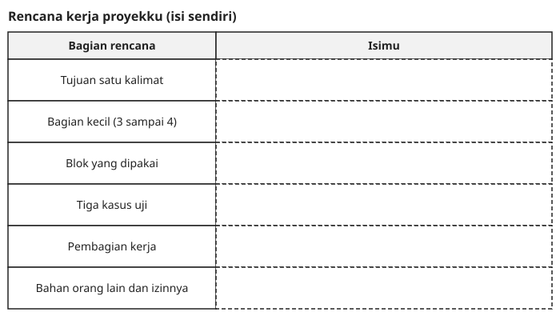

**Ingat dulu:** Tanpa melihat modul:

1. Sebutkan tiga hal yang tidak boleh ada di karya yang dibagikan. ______
2. Tulis urutan `ask`, `if`, dan `change` untuk satu soal kuis, dan jelaskan mengapa urutannya begitu. ______
3. Tulis lima langkah mencari kesalahan dari menjalankan sampai uji ulang. ______



`[Gambar: tabel dua kolom Bagian rencana dan Isimu. Enam baris: Tujuan satu kalimat, Bagian kecil (3 sampai 4), Blok yang dipakai, Tiga kasus uji, Pembagian kerja, Bahan orang lain dan izinnya. Kolom Isimu kosong; isi dengan rencana proyekmu sendiri.]`

**Prediksi:** Program U adalah satu bagian dari sebuah game: bola jatuh dari atas, dan skor bertambah bila bola melewati garis y = -100.

```text
when green flag clicked
set [skor] to (0)
go to x: (0) y: (150)
repeat (60)
  change y by (-5)
  if <(y position) < (-100)> then
    change [skor] by (1)
    go to x: (0) y: (150)
```

Skor menjadi 1 pada putaran ke ______ . Skor setelah 60 putaran: ______

Telusuri dengan tabel yang berisi putaran, `y`, dan `skor` di kertasmu.

**Lengkapi:** Isi tabel rencana kerja pada gambar untuk animasi atau game satu layarmu sendiri. Tunjukkan ke gurumu sebelum mulai membuat.

**Latihan:**

1. Susun produk dari bagian kecil dan uji tiap bagian sebelum menggabungkannya.
2. Jalankan tiga kasus ujimu. Bila ada yang gagal, tulis catatan penyebab seperti di `SMP7-1-M11`. ______
3. Program U diubah: `repeat (60)` menjadi `repeat (110)`. Skor akhir: ______
4. Pada program U, tambahkan cabang `else` berisi `say [Belum] for (0) seconds`. Cabang mana yang berjalan pada putaran 1? ______
5. Jelaskan produkmu lisan dalam satu menit: tujuan, bagian kecil, satu galat yang kamu temukan, dan satu hal yang akan kamu ubah.

**Cek diri:**

- [ ] Aku punya rencana kerja sebelum membuat.
- [ ] Aku menguji dengan tiga kasus.
- [ ] Aku bisa menjelaskan produkku dalam satu menit.

**Catatan cetak (untuk guru, tidak dicetak):** satu lembar A4, dua halaman. Bagian Susun dilewati karena modul minggu proyek tidak punya soal urutan. Kunci ada di modul `SMP7-1-M13`, bagian "Contoh terselesaikan" dan "Cek mandiri". Lembar tidak memuat kolom nama, kelas, tanggal, atau nilai.
