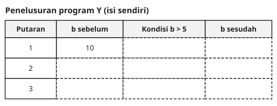

**Ingat dulu:** Tutup semua catatan dan modul. Jawab dulu, baru periksa kunci di modul.

1. Tanpa melihat, telusuri di kertas algoritma robot `MAJU`, `MAJU`, `KANAN`, `MAJU`, `KIRI`, `MAJU` dari (1, 1) menghadap atas. ______
2. Tanpa melihat, tulis program yang menggambar segitiga sama sisi. ______
3. Tulis papan rencana cerita pendek tiga adegan dari ingatan, tanpa contoh. ______



`[Gambar: tabel dengan kolom Putaran, b sebelum, Kondisi b > 5, dan b sesudah. Tiga baris putaran 1 sampai 3; hanya b sebelum pada putaran 1 yang sudah berisi 10. Sel lain kosong; isi pada bagian Lengkapi.]`

**Prediksi:** Tulis prediksimu sebelum menelusuri. Program X:

```text
when green flag clicked
set [a] to (3)
repeat (2)
  if <(a) > (4)> then
    change [a] by (-2)
  else
    change [a] by (3)
```

Isi `a` pada akhirnya: ______

Lalu telusuri per putaran di kertasmu.

**Lengkapi:** Isi sendiri tabel penelusuran pada gambar untuk program Y.

```text
when green flag clicked
set [b] to (10)
repeat (3)
  if <(b) > (5)> then
    change [b] by (-4)
```

**Latihan** (AI: tanpa AI; kerjakan tanpa catatan, periksa dengan kunci hanya sesudah selesai):

1. Tulis kuis satu soal ("Berapa 8 + 5?") dengan skor dan ucapan hasil, dari ingatan. ______
2. Program: `repeat (3)` berisi `move (70) steps` dan `turn right (90) degrees`, seharusnya segitiga sama sisi. Tulis catatan penyebab dan aturan umumnya. ______
3. `set [nyawa] to (3)`, lalu `repeat (3)` berisi `change [nyawa] by (-1)` dan `if <(nyawa) = (0)> then say [Habis] for (1) seconds`. Pada putaran berapa sprite mengucap "Habis"? ______
4. Tulis rencana kerja tiga bagian untuk game satu layar. ______

**Cek diri:** Jurnal refleksi; tulis sendiri di kertasmu dan jangan menulis data pribadi.

- [ ] Soal mana yang paling mudah kujawab, dan mengapa menurutku begitu?
- [ ] Soal mana yang paling sulit atau salah, dan apa satu hal yang akan kulatih ulang?
- [ ] Cara belajar mana yang akan kupakai lagi semester depan?

**Catatan cetak (untuk guru, tidak dicetak):** satu lembar A4, dua halaman. Bagian Susun dilewati karena modul minggu ini berisi kuis mengingat. Kunci "Latihan" ada di modul `SMP7-1-M14`, bagian "Catatan untuk guru". Lembar tidak memuat kolom nama, kelas, tanggal, atau nilai.
