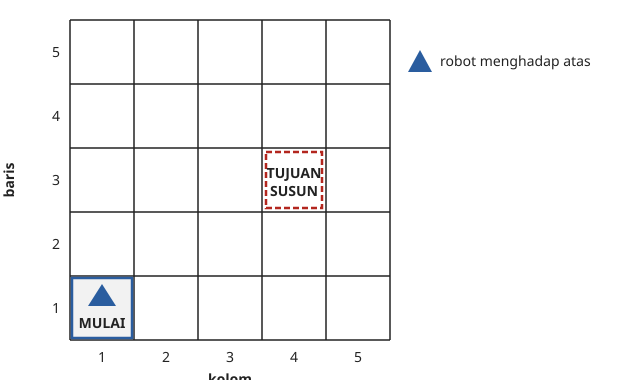

**Ingat dulu:** Tanpa melihat modul:

1. Sebutkan tiga kebiasaan kartu instruksi yang tepat. ______
2. Mengapa "Tuang air." kurang tepat untuk robot? ______
3. Kartu: "Beri gula. Aduk." Apa yang berubah bila urutannya dibalik? ______



`[Gambar: kisi lima kolom kali lima baris. Kolom 1 sampai 5 dari kiri, baris 1 sampai 5 dari bawah. Petak (1, 1) bertanda MULAI dengan panah menghadap atas. Petak (4, 3) bertanda TUJUAN SUSUN. Pakai kisi ini untuk menelusuri robot.]`

**Prediksi:** Robot mulai di (1, 1) menghadap atas. Petak ditulis (kolom, baris). Perintahnya: `MAJU` pindah satu petak ke arah hadap, `KANAN` putar 90 derajat ke kanan di petak yang sama, `KIRI` putar 90 derajat ke kiri di petak yang sama.

Algoritma P: `MAJU`, `MAJU`, `KANAN`, `MAJU`, `KIRI`, `MAJU`.

Robot berhenti di petak ______ , menghadap ______ .

Sesudah temanmu menggerakkan benda "robot", isi tabel penelusuran ini:

| Langkah | Perintah | Petak | Menghadap |
| --- | --- | --- | --- |
| 0 | (mulai) | (1, 1) | atas |
| 1 | | | |
| 2 | | | |
| 3 | | | |
| 4 | | | |
| 5 | | | |
| 6 | | | |

Prediksiku mulai berbeda di langkah ______ .

**Lengkapi:** Dari (1, 1) menghadap atas, robot harus sampai di (4, 2). Isi bagian kosong, lalu telusuri di tabelmu sendiri.

```text setengah-jadi
MAJU
______
MAJU
MAJU
MAJU
```

**Susun:** Enam kartu berikut diacak. Susun menjadi algoritma yang membawa robot dari (1, 1), menghadap atas, ke petak (4, 3).

- **A.** `MAJU`
- **B.** `KANAN`
- **C.** `MAJU`
- **D.** `MAJU`
- **E.** `MAJU`
- **F.** `MAJU`

Urutanku: ______ , ______ , ______ , ______ , ______ , ______

**Latihan:**

1. Tulis algoritma dengan tiga perintah di atas yang membawa robot dari (1, 1) ke (5, 1), lalu ke (5, 5). Jumlah perintah yang kamu pakai: ______
2. Tulis satu algoritma yang urutannya salah, tetapi robot tetap sampai di tempat yang benar. Apakah hal itu mungkin? ______
3. Dengan dua kalimat, jelaskan mengapa `KANAN` tidak sama dengan "pindah ke kanan". ______

**Cek diri:**

- [ ] Aku bisa menyebut arti algoritma.
- [ ] Aku bisa menelusuri algoritma sampai petak akhir dan arah hadap.
- [ ] Aku bisa menunjukkan akibat urutan yang salah.

**Catatan cetak (untuk guru, tidak dicetak):** satu lembar A4, satu halaman. Kunci ada di modul `SMP7-1-M2`, bagian "Contoh terselesaikan", "Latihan", dan "Cek mandiri". Lembar tidak memuat kolom nama, kelas, tanggal, atau nilai.
