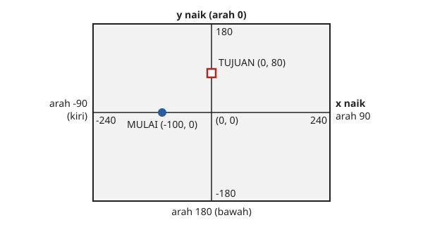

**Ingat dulu:** Tanpa melihat modul:

1. Tulis arti kata **algoritma** dengan kalimatmu sendiri. ______
2. Robot di (1, 1) menghadap atas menjalankan `MAJU`, `KANAN`, `MAJU`. Di mana robot berhenti dan menghadap ke mana? ______



`[Gambar: panggung Scratch berukuran 480 x 360 titik dengan titik tengah (0, 0). x makin besar ke kanan, y makin besar ke atas. Arah 90 kanan, 0 atas, 180 bawah, -90 kiri. Titik MULAI (-100, 0) dan TUJUAN (0, 80) ditandai untuk bagian Lengkapi.]`

**Prediksi:** Program R (satu baris satu blok, angka dalam kurung):

```text
when green flag clicked
go to x: (-100) y: (-60)
point in direction (90)
move (100) steps
turn left (90) degrees
move (80) steps
turn right (90) degrees
move (100) steps
```

Sprite berhenti di titik ______ , menghadap arah ______ .

Telusuri program R, isi tabel (x, y, arah setelah tiap blok):

| Blok | x | y | Arah |
| --- | --- | --- | --- |
| `go to x: (-100) y: (-60)` | | | |
| `point in direction (90)` | | | |
| `move (100) steps` | | | |
| `turn left (90) degrees` | | | |
| `move (80) steps` | | | |
| `turn right (90) degrees` | | | |
| `move (100) steps` | | | |

**Lengkapi:** Sprite mulai di (-100, 0) menghadap kanan dan harus berhenti di (0, 80). Isi bagian kosong, lalu telusuri.

```text setengah-jadi
when green flag clicked
go to x: (-100) y: (0)
point in direction (90)
move (______) steps
turn left (______) degrees
move (______) steps
```

**Susun:** Enam blok berikut diacak. Susun menjadi program yang membawa sprite dari (0, 0) menghadap kanan, maju 50, naik 50, lalu berhenti.

- **A.** `move (50) steps`
- **B.** `when green flag clicked`
- **C.** `turn left (90) degrees`
- **D.** `go to x: (0) y: (0)`
- **E.** `move (50) steps`
- **F.** `point in direction (90)`

Urutanku: ______ , ______ , ______ , ______ , ______ , ______

**Latihan:**

1. Pada program R, ganti hanya `turn left (90) degrees` menjadi `turn right (90) degrees`. Prediksi titik dan arah akhirnya: ______ Lalu telusuri untuk membuktikannya.
2. Buat program rute huruf L: mulai di (-80, 80), turun 120, lalu ke kanan 100. Tulis dan telusuri di kertas: ______
3. Dengan dua kalimat, jelaskan beda `go to` dan `move`. ______

**Cek diri:**

- [ ] Aku bisa menyebut panggung, sprite, dan blok.
- [ ] Aku bisa menyebut titik tengah panggung dan ke mana x bertambah.
- [ ] Aku bisa menelusuri posisi dan arah sprite di tabel.

**Catatan cetak (untuk guru, tidak dicetak):** satu lembar A4, satu sampai dua halaman. Kunci ada di modul `SMP7-1-M3`, bagian "Contoh terselesaikan" dan "Cek mandiri". Lembar tidak memuat kolom nama, kelas, tanggal, atau nilai.
