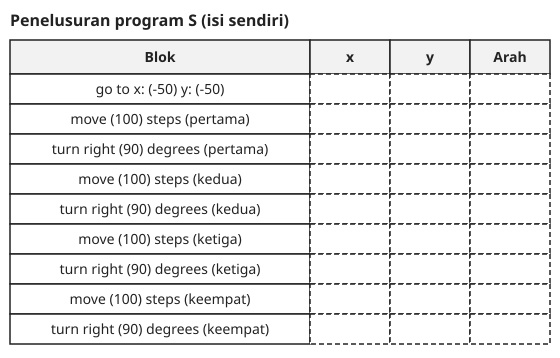

**Ingat dulu:** Tanpa melihat modul:

1. Berapa titik tengah panggung, dan arah berapa yang berarti menghadap kanan? ______
2. Sprite di (0, 0) menghadap kanan menjalankan `move (30) steps`, `turn left (90) degrees`, `move (20) steps`. Di mana ia berhenti? ______
3. Mengapa menukar dua perintah robot bisa membuatnya berhenti di petak yang salah? ______



`[Gambar: tabel dengan kolom Blok, x, y, dan Arah. Baris pertama go to x: (-50) y: (-50), lalu empat pasang move (100) steps dan turn right (90) degrees bernomor pertama sampai keempat. Kolom x, y, dan Arah kosong; isi saat menelusuri program S di bagian Prediksi.]`

**Prediksi:** `pen down` membuat sprite meninggalkan garis saat bergerak, `pen up` menghentikannya, `erase all` menghapus gambar. `when [space] key pressed` menjadi topi: skrip di bawahnya berjalan saat peristiwa itu terjadi.

Program S:

```text
when [space] key pressed
erase all
go to x: (-50) y: (-50)
point in direction (90)
pen down
move (100) steps
turn right (90) degrees
move (100) steps
turn right (90) degrees
move (100) steps
turn right (90) degrees
move (100) steps
turn right (90) degrees
pen up
```

Gambar yang muncul saat spasi ditekan: ______

Arah sprite pada akhirnya: ______

Telusuri program S dan isi tabel pada gambar. Mengapa arah akhir begitu? ______

**Lengkapi:** Program yang menggambar persegi sisi 80 dari titik (-40, 0).

```text setengah-jadi
when green flag clicked
erase all
go to x: (-40) y: (0)
point in direction (90)
pen down
move (______) steps
turn right (______) degrees
move (______) steps
turn right (______) degrees
move (______) steps
turn right (______) degrees
move (______) steps
turn right (______) degrees
pen up
```

**Susun:** Tujuh blok berikut diacak. Susun menjadi pembuka program persegi sisi 60 sampai sisi pertama selesai, dijalankan saat bendera hijau diklik.

- **A.** `pen down`
- **B.** `when green flag clicked`
- **C.** `erase all`
- **D.** `point in direction (90)`
- **E.** `move (60) steps`
- **F.** `turn right (90) degrees`
- **G.** `go to x: (-30) y: (30)`

Urutanku: ______ , ______ , ______ , ______ , ______ , ______ , ______

Mengapa `pen down` tidak boleh mendahului `go to`? ______

**Latihan:**

1. Tulis program segitiga sisi 100 dengan topi `when [t] key pressed`. Tulis arah sprite setelah tiap `turn`: ______
2. Hilangkan `turn right (90) degrees` yang paling akhir dari program S. Prediksi gambar dan arah akhir sprite: ______
3. Buat persegi panjang 150 x 80 dan tulis tabel penelusurannya di kertas.
4. Dengan dua kalimat, jelaskan beda `go to` sebelum `pen down` dan sesudah `pen down`. ______

**Cek diri:**

- [ ] Aku bisa menyebut fungsi blok `when [space] key pressed`.
- [ ] Aku bisa menyebut berapa derajat sprite diputar tiap sudut persegi dan segitiga sama sisi.
- [ ] Aku bisa menjelaskan mengapa persegi memakai empat `move` dan empat `turn`.

**Catatan cetak (untuk guru, tidak dicetak):** satu lembar A4, dua halaman. Kunci ada di modul `SMP7-1-M4`, bagian "Contoh terselesaikan" dan "Cek mandiri". Lembar tidak memuat kolom nama, kelas, tanggal, atau nilai.
