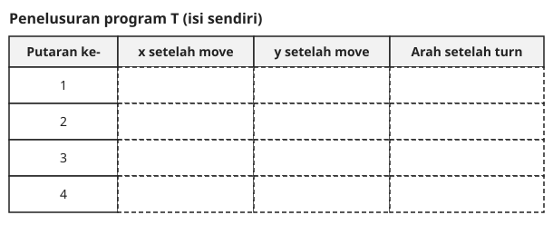

**Ingat dulu:** Tanpa melihat modul:

1. Berapa derajat sprite diputar tiap sudut persegi, dan berapa untuk segitiga sama sisi? ______
2. Robot di (1, 1) menghadap atas menjalankan `KANAN`, `MAJU`, `MAJU`. Di mana ia berhenti? ______
3. Buka kartu teh dari minggu pertama. Langkah mana yang bisa ditulis lebih singkat kalau kamu punya cara menyebut "ulangi"? ______



`[Gambar: tabel dengan kolom Putaran ke-, x setelah move, y setelah move, dan Arah setelah turn. Empat baris bernomor 1 sampai 4 dengan sel kosong; isi saat menelusuri program T.]`

**Prediksi:** Program T:

```text
when green flag clicked
erase all
go to x: (-50) y: (-50)
point in direction (90)
pen down
repeat (4)
  move (100) steps
  turn right (90) degrees
pen up
```

Bandingkan T dengan program S minggu lalu. Gambarnya sama atau berbeda? ______ Berapa baris yang tersisa dibandingkan S? ______

Telusuri T dan isi tabel pada gambar. Apa yang berubah dari putaran ke putaran, dan apa yang tetap sama? ______

**Lengkapi:** Segitiga sama sisi sisi 100 dari titik (-50, -50).

```text setengah-jadi
when green flag clicked
erase all
go to x: (-50) y: (-50)
point in direction (90)
pen down
repeat (______)
  move (100) steps
  turn right (______) degrees
pen up
```

**Susun:** Enam baris berikut diacak. Susun menjadi program yang menggambar persegi sisi 100 saat bendera hijau diklik. Arah awal sudah 90.

- **A.** `when green flag clicked`
- **B.** `repeat (4)`
- **C.** `move (100) steps` (di dalam `repeat`)
- **D.** `turn right (90) degrees` (di dalam `repeat`)
- **E.** `go to x: (-50) y: (-50)`
- **F.** `pen down`

Urutanku: ______ , ______ , ______ , ______ , ______ , ______

Mengapa `pen down` harus sesudah `go to` dan sebelum `repeat`? ______

**Latihan:**

1. Ubah program T agar menggambar persegi sisi 60. Hanya satu angka yang berubah. Angka yang mana? ______
2. Gambar persegi panjang 150 x 80 dari titik (-75, -40) dengan `repeat (2)` yang membungkus empat blok. Tulis programnya di kertas.
3. Tulis kartu "mengaduk teh" dari minggu pertama sebagai pseudocode dengan satu baris "ulangi 10 kali". ______
4. Dengan dua kalimat, jelaskan kapan memakai `repeat (n)` dan kapan `forever`. ______

**Cek diri:**

- [ ] Aku bisa menjelaskan arti `repeat (4)` pada program T.
- [ ] Aku bisa menghitung berapa kali `move` berjalan pada `repeat (3)` yang berisi dua `move`.
- [ ] Aku bisa menyebut kapan memakai `forever`.

**Catatan cetak (untuk guru, tidak dicetak):** satu lembar A4, dua halaman. Kunci ada di modul `SMP7-1-M5`, bagian "Contoh terselesaikan" dan "Cek mandiri". Lembar tidak memuat kolom nama, kelas, tanggal, atau nilai.
