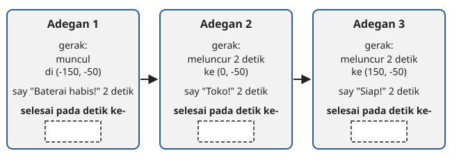

**Ingat dulu:** Tanpa melihat modul:

1. Pada program persegi `SMP7-1-M5`, bagian mana yang bisa dibungkus perulangan, dan berapa jumlah ulangnya? ______
2. Ambil satu tugas sehari-hari yang panjang, misalnya menyiapkan tas atau mencuci piring. Pecah menjadi tiga bagian yang masing-masing punya algoritma sendiri. ______



`[Gambar: tiga kotak berpanah bernama Adegan 1, Adegan 2, dan Adegan 3. Adegan 1: robot muncul di (-150, -50), ucapan "Baterai habis!" 2 detik. Adegan 2: meluncur 2 detik ke (0, -50), ucapan "Toko!" 2 detik. Adegan 3: meluncur 2 detik ke (150, -50), ucapan "Siap!" 2 detik. Tiap kotak punya isian kosong "selesai pada detik ke-".]`

**Prediksi:** Program U menuliskan papan rencana itu untuk satu sprite.

```text
when green flag clicked
switch backdrop to [Adegan 1]
go to x: (-150) y: (-50)
say [Baterai habis!] for (2) seconds
switch backdrop to [Adegan 2]
glide (2) secs to x: (0) y: (-50)
say [Toko!] for (2) seconds
switch backdrop to [Adegan 3]
glide (2) secs to x: (150) y: (-50)
say [Siap!] for (2) seconds
```

Seluruh cerita berjalan ______ detik. Saat mengucap "Toko!", robot berada di x = ______ .

Telusuri program U dan isi isian waktu pada gambar. Cocok dengan prediksimu? ______

**Lengkapi:** Adegan ke-4: robot menari dengan menggeser beberapa kali.

```text setengah-jadi
switch backdrop to [Adegan 3]
repeat (______)
  move (10) steps
  move (-10) steps
say [Hore!] for (______) seconds
```

Posisi x sesudah `repeat` dan waktu totalnya: ______

**Susun:** Enam baris berikut diacak. Susun menjadi adegan 2 dan 3 mengikuti papan rencana pada gambar.

- **A.** `say [Siap!] for (2) seconds`
- **B.** `glide (2) secs to x: (150) y: (-50)`
- **C.** `switch backdrop to [Adegan 2]`
- **D.** `say [Toko!] for (2) seconds`
- **E.** `switch backdrop to [Adegan 3]`
- **F.** `glide (2) secs to x: (0) y: (-50)`

Urutanku: ______ , ______ , ______ , ______ , ______ , ______

Mengapa latar harus diganti sebelum `glide` yang menggeser robot ke adegan itu? ______

**Latihan:**

1. Ubah semua `say ... for (2) seconds` menjadi 1 detik. Prediksi waktu total baru: ______ Lalu telusuri.
2. Tulis papan rencana cerita tiga adegan baru dengan tokoh dan tempat pilihanmu (tanpa nama orang nyata), lalu tulis programnya.
3. Tulis dekomposisi program yang menggambar rumah sederhana: persegi sisi 100 dengan segitiga sama sisi sisi 100 di atasnya. ______
4. Dengan dua kalimat, jelaskan mengapa memecah masalah memudahkan kerja tim. ______

**Cek diri:**

- [ ] Aku bisa menyebut arti dekomposisi.
- [ ] Aku bisa menghitung total detik program cerita.
- [ ] Aku bisa menjelaskan mengapa papan rencana ditulis sebelum program.

**Catatan cetak (untuk guru, tidak dicetak):** satu lembar A4, dua halaman. Kunci ada di modul `SMP7-1-M6`, bagian "Contoh terselesaikan" dan "Cek mandiri". Lembar tidak memuat kolom nama, kelas, tanggal, atau nilai.
