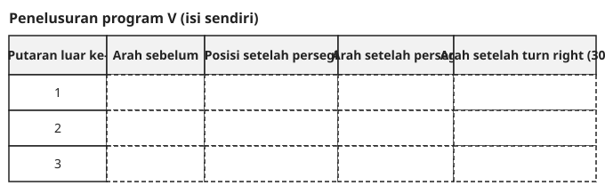

**Ingat dulu:** Tanpa melihat modul:

1. Tulis arti **dekomposisi** dengan kalimatmu sendiri. ______
2. Sprite di (0, 0) menghadap kanan menjalankan `move (40) steps`, `turn right (90) degrees`, `move (40) steps`. Di mana ia berhenti dan menghadap ke mana? ______
3. Berapa derajat sprite diputar tiap sudut persegi dan segitiga sama sisi? ______



`[Gambar: tabel dengan kolom Putaran luar ke-, Arah sebelum, Posisi setelah persegi, Arah setelah persegi, dan Arah setelah turn right (30). Tiga baris bernomor 1 sampai 3 dengan sel kosong; isi saat menelusuri program V.]`

**Prediksi:** Program V menaruh perulangan di dalam perulangan.

```text
when green flag clicked
erase all
go to x: (0) y: (0)
point in direction (90)
pen down
repeat (3)
  repeat (4)
    move (50) steps
    turn right (90) degrees
  turn right (30) degrees
pen up
```

Berapa persegi yang tergambar? ______ Arah sprite pada akhirnya? ______

Telusuri V dan isi tabel pada gambar. Apa yang kamu lihat pada posisi sprite setelah tiap persegi selesai? ______

**Lengkapi:** Segi lima sisi 50. Isi bagian kosong memakai aturan 360 dibagi jumlah sisi.

```text setengah-jadi
when green flag clicked
erase all
go to x: (0) y: (0)
point in direction (90)
pen down
repeat (______)
  move (50) steps
  turn right (______) degrees
pen up
```

**Susun:** Enam baris berikut diacak. Susun menjadi program V tanpa pena, dengan indentasi yang benar. Arah awal 90.

- **A.** `when green flag clicked`
- **B.** `repeat (3)`
- **C.** `repeat (4)` (di dalam `repeat (3)`)
- **D.** `move (50) steps` (di dalam `repeat (4)`)
- **E.** `turn right (90) degrees` (di dalam `repeat (4)`)
- **F.** `turn right (30) degrees` (di dalam `repeat (3)`, setelah `repeat (4)`)

Urutanku: ______ , ______ , ______ , ______ , ______ , ______

Mengapa F harus di luar `repeat (4)` tetapi di dalam `repeat (3)`? ______

**Latihan:**

1. Ubah V menjadi `repeat (12)` luar dan `turn right (30)`. Prediksi arah akhir sprite: ______
2. Tulis program segi delapan sisi 40 memakai aturan umum. Sudut putarnya: ______
3. Lengkapi tabel generalisasi untuk n = 10 dan n = 12, lalu periksa apakah aturan 360 dibagi n tetap berlaku.

| Jumlah sisi n | Sudut putar | n x sudut |
| --- | --- | --- |
| 10 | | |
| 12 | | |

4. Tulis deretan 3, 6, 9, 12, ... lalu aturannya dan angka ke-10. ______

**Cek diri:**

- [ ] Aku bisa menyebut sudut putar untuk segi lima beraturan.
- [ ] Aku bisa menjelaskan beda pola dan generalisasi.
- [ ] Aku bisa menelusuri perulangan di dalam perulangan.

**Catatan cetak (untuk guru, tidak dicetak):** satu lembar A4, dua halaman. Kunci ada di modul `SMP7-1-M7`, bagian "Contoh terselesaikan" dan "Cek mandiri". Lembar tidak memuat kolom nama, kelas, tanggal, atau nilai.
