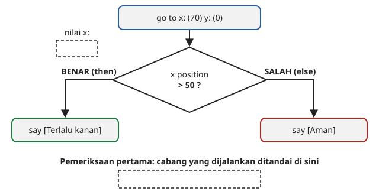

**Ingat dulu:** Tanpa melihat modul:

1. Tulis aturan sudut putar untuk bentuk beraturan dengan n sisi, lalu hitung untuk n = 5. ______
2. Sebutkan blok topi yang memulai program, dan jelaskan apa yang terjadi bila tidak ada blok topi. ______
3. Apa beda `repeat (n)` dan `forever`? ______



`[Gambar: kotak go to x: (70) y: (0), lalu belah ketupat "x position > 50 ?". Cabang BENAR (then) menuju kotak say [Terlalu kanan], cabang SALAH (else) menuju kotak say [Aman]. Ada kotak kosong "nilai x" dan kotak kosong untuk menandai cabang yang dijalankan pada pemeriksaan pertama.]`

**Prediksi:** Program P (arah awal sprite 90):

```text
when green flag clicked
go to x: (70) y: (0)
point in direction (90)
if <(x position) > (50)> then
  say [Terlalu kanan] for (1) seconds
else
  say [Aman] for (1) seconds
move (-30) steps
if <(x position) > (50)> then
  say [Terlalu kanan] for (1) seconds
else
  say [Aman] for (1) seconds
```

Pemeriksaan pertama diucapkan: ______ . Pemeriksaan kedua diucapkan: ______

Telusuri P dan isi tabel. Isi juga kotak pada gambar.

| Blok | x | Kondisi (benar atau salah) | Ucapan |
| --- | --- | --- | --- |
| `go to x: (70) y: (0)` | | | |
| `if` pertama | | | |
| `move (-30) steps` | | | |
| `if` kedua | | | |

**Lengkapi:** Sprite di x = -20 harus mengucapkan "Di kiri tengah" bila berada di kiri titik tengah panggung.

```text setengah-jadi
when green flag clicked
go to x: (-20) y: (0)
if <(x position) < (______)> then
  say [Di kiri tengah] for (1) seconds
else
  say [Di kanan tengah] for (1) seconds
```

Ucapan yang muncul: ______ . Bila posisi awal diubah menjadi x = 30, ucapan yang baru: ______

**Susun:** Enam baris berikut diacak. Susun menjadi program yang mengucapkan "Kanan" bila x lebih besar dari 0 dan "Kiri" bila tidak, dengan sprite mulai di x = 30.

- **A.** `when green flag clicked`
- **B.** `if <(x position) > (0)> then`
- **C.** `say [Kanan] for (1) seconds` (di dalam `then`)
- **D.** `else`
- **E.** `go to x: (30) y: (0)`
- **F.** `say [Kiri] for (1) seconds` (di dalam `else`)

Urutanku: ______ , ______ , ______ , ______ , ______ , ______

Mengapa `go to` harus sebelum `if`? ______

**Latihan:**

1. Pada program P, ganti angka 50 menjadi 30 pada kondisi kedua saja. Prediksi ucapan kedua: ______
2. Tulis program yang menaruh sprite di x = -100 dan mengucapkan "Jauh" bila x lebih kecil dari -50, kalau tidak "Dekat". ______
3. Tulis program dengan `forever` dan `if <key [right arrow] pressed?> then` yang menggeser sprite 10 langkah ke kanan. Kapan kondisi diperiksa? ______
4. Dengan dua kalimat, jelaskan beda `if` dan `if ... else`. ______

**Cek diri:**

- [ ] Aku bisa menyebut arti kondisi dan nilai apa saja yang mungkin.
- [ ] Aku bisa menelusuri cabang yang berjalan.
- [ ] Aku bisa menyebut kapan kondisi diperiksa.

**Catatan cetak (untuk guru, tidak dicetak):** satu lembar A4, dua halaman. Kunci ada di modul `SMP7-1-M8`, bagian "Contoh terselesaikan" dan "Cek mandiri". Lembar tidak memuat kolom nama, kelas, tanggal, atau nilai.
