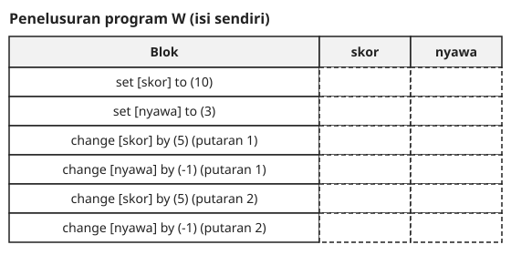

**Ingat dulu:** Tanpa melihat modul:

1. Pada `repeat (n)`, sebut dua hal yang berubah tiap putaran dan satu hal yang tetap. ______
2. Apa yang dijalankan `if ... else` bila kondisinya salah? ______
3. Tulis arti **dekomposisi** dengan kalimatmu sendiri. ______



`[Gambar: tabel dengan kolom Blok, skor, dan nyawa. Enam baris: set skor ke 10, set nyawa ke 3, lalu change skor dan change nyawa untuk putaran 1 dan putaran 2. Kolom skor dan nyawa kosong; isi saat menelusuri program W.]`

**Prediksi:** `set [skor] to (10)` mengganti isi kotak, `change [skor] by (5)` menambah isinya (angka negatif mengurangi). Program W:

```text
when green flag clicked
set [skor] to (10)
set [nyawa] to (3)
repeat (2)
  change [skor] by (5)
  change [nyawa] by (-1)
say (skor) for (2) seconds
```

Isi akhir `skor`: ______ . Isi akhir `nyawa`: ______ . Yang diucapkan sprite: ______

Telusuri W dan isi tabel pada gambar.

**Lengkapi:** Sprite harus mengucapkan 8 sesudah empat putaran. Ada lebih dari satu jawaban benar; tuliskan satu pasangan.

```text setengah-jadi
when green flag clicked
set [tekan] to (______)
repeat (4)
  change [tekan] by (______)
say (tekan) for (2) seconds
```

**Susun:** Lima baris berikut diacak. Susun menjadi program yang mengucapkan skor 30 sesudah tiga putaran.

- **A.** `when green flag clicked`
- **B.** `set [skor] to (0)`
- **C.** `repeat (3)`
- **D.** `change [skor] by (10)` (di dalam `repeat`)
- **E.** `say (skor) for (2) seconds`

Urutanku: ______ , ______ , ______ , ______ , ______

Mengapa `set` harus sebelum `repeat` dan `say` sesudah `repeat`? ______

**Latihan:**

1. Pada program W, ubah `change [nyawa] by (-1)` menjadi `change [nyawa] by (-2)`. Prediksi nilai akhir `nyawa`: ______
2. Tulis program yang mengisi `skor` dengan 0, menambahnya 4 kali masing-masing 25, lalu mengucapkan hasilnya. ______
3. Program: `set [skor] to (2)`, lalu `repeat (3)` berisi `change [skor] by (skor)`. Tulis nilai `skor` tiap putaran: ______
4. Dengan dua kalimat, jelaskan beda `set` dan `change`. ______

**Cek diri:**

- [ ] Aku bisa menyebut arti variabel.
- [ ] Aku bisa menelusuri nilai variabel setelah `set` dan `change`.
- [ ] Aku bisa menjelaskan mengapa program yang menghitung skor perlu `set` di awal.

**Catatan cetak (untuk guru, tidak dicetak):** satu lembar A4, dua halaman. Kunci ada di modul `SMP7-1-M9`, bagian "Contoh terselesaikan" dan "Cek mandiri". Lembar tidak memuat kolom nama, kelas, tanggal, atau nilai.
