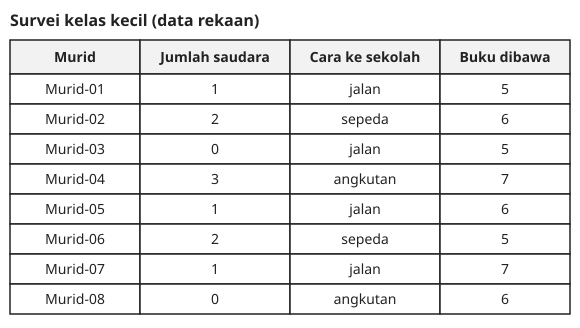

**Ingat dulu:** Tanpa melihat modul:

1. Tulis arti algoritma dan tiga kebiasaan kartu instruksi yang tepat. ______
2. Apa beda `set` dan `change` pada variabel? ______
3. Tulis arti **dekomposisi** dengan kalimatmu sendiri. ______

`[Gambar: tabel dengan kolom Murid, Jumlah saudara, Cara ke sekolah, dan Buku dibawa. Delapan baris rekaan Murid-01 sampai Murid-08: saudara 1, 2, 0, 3, 1, 2, 1, 0; cara ke sekolah jalan, sepeda, jalan, angkutan, jalan, sepeda, jalan, angkutan; buku 5, 6, 5, 7, 6, 5, 7, 6.]`

**Prediksi:** Pandang tabel tanpa menghitung. Cara ke sekolah yang paling banyak: ______ , sebanyak ______ murid.

Sekarang hitung dengan tanda garis (tally):

| Cara ke sekolah | Tally | Banyaknya |
| --- | --- | --- |
| jalan | | |
| sepeda | | |
| angkutan | | |

Data yang sudah diolah ini dapat ditulis sebagai informasi satu kalimat: ______

**Lengkapi:** Hitung banyaknya murid untuk tiap jumlah buku dari tabel yang sama.

| Buku dibawa | Murid | Banyaknya |
| --- | --- | --- |
| 5 | 01, 03, 06 | 3 |
| 6 | ______ | ______ |
| 7 | ______ | ______ |

Jumlah kolom terakhir harus sama dengan banyaknya baris tabel. Cocok? ______

**Susun:** Enam langkah mengubah data menjadi informasi diacak. Susun dalam urutan yang benar.

- **A.** Tulis pertanyaan yang ingin dijawab.
- **B.** Kumpulkan data dan rapikan dalam tabel.
- **C.** Pilih kolom yang dibutuhkan pertanyaan.
- **D.** Hitung atau bandingkan nilainya.
- **E.** Tulis kesimpulan satu kalimat.
- **F.** Periksa bahwa jumlah hitungan sama dengan banyak baris.

Urutanku: ______ , ______ , ______ , ______ , ______ , ______

Mengapa pertanyaan ditulis lebih dulu? ______

**Latihan:**

1. Ganti cara ke sekolah Murid-05 menjadi sepeda. Hitung ulang tally dan tulis informasi barunya. ______
2. Tulis tabel lima baris rekaan (nama "Murid-A" dan seterusnya) tentang hewan peliharaan di rumah, satu pilihan per baris: kucing, burung, atau tidak ada. Hitung kemunculannya.
3. Mana yang diskrit: banyak buku di tas, berat tas dalam kilogram, pilihan warna sampul? Beri alasan satu kalimat. ______
4. Dengan dua kalimat, jelaskan beda data dan informasi memakai contoh dari tabel. ______

**Cek diri:**

- [ ] Aku bisa menyebut beda data dan informasi.
- [ ] Aku bisa menyebut arti data diskrit dan memberi satu contoh.
- [ ] Aku bisa menjelaskan mengapa jumlah hitungan perlu diperiksa terhadap banyak baris.

**Catatan cetak (untuk guru, tidak dicetak):** satu lembar A4, dua halaman. Kunci ada di modul `SMP7-2-M1`, bagian "Contoh terselesaikan" dan "Cek mandiri". Lembar tidak memuat kolom nama, kelas, tanggal, atau nilai.
