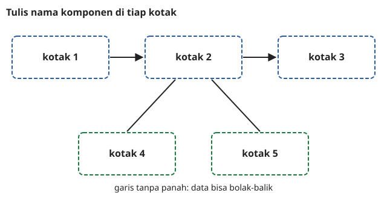

**Ingat dulu:** Tanpa melihat modul:

1. Apa beda `broadcast` dan `broadcast and wait`? ______
2. Jelaskan mengapa komputer menyimpan data dengan dua nilai, 0 dan 1. ______
3. Beri satu contoh data, lalu ubah menjadi informasi yang menjawab satu pertanyaan. ______

`[Gambar: tiga kotak kosong berderet kiri ke kanan (kotak 1, 2, 3) dihubungkan panah, dan dua kotak kosong di bawah (kotak 4 dan 5) dihubungkan garis tanpa kepala panah ke kotak tengah. Tulis nama komponen di tiap kotak setelah mengerjakan Prediksi.]`

**Prediksi:** Pilihan komponen: masukan, memori, prosesor, keluaran, penyimpanan. Kamu menekan panah kanan pada game Scratch. Enam kejadian berikut terjadi berurutan. Isi kolom tebakan sebelum membuka modul.

| No | Kejadian | Komponen yang bekerja (tebakan) |
| --- | --- | --- |
| 1 | Jarimu menekan tombol panah kanan. | |
| 2 | Tombol terbaca dan tekanannya diterima komputer. | |
| 3 | Program game yang sedang jalan berada di tempat penyimpanan sementara. | |
| 4 | Posisi baru dihitung: x = x + 10. | |
| 5 | Gambar sprite digambar ulang di posisi baru. | |
| 6 | Skor terakhir ditulis ke berkas supaya masih ada besok. | |

Baris yang membuatku ragu: ______

Lalu tulis nama komponen pada kotak di gambar.

**Lengkapi:** Pemutar musik di ponsel. Isi kolom komponen dengan salah satu: masukan, memori, prosesor, keluaran, penyimpanan.

| Kejadian | Komponen |
| --- | --- |
| Kamu mengetuk tombol putar di layar sentuh. | ______ |
| Berkas lagu dibaca dari tempat ia disimpan jangka panjang. | ______ |
| Potongan lagu yang sedang diputar menunggu di tempat sementara. | ______ |
| Instruksi memutar dan mengatur volume dikerjakan. | ______ |
| Suara keluar dari pengeras suara. | ______ |

**Susun:** Lima kejadian berikut diacak. Susun urutan yang terjadi saat kamu menggambar di program gambar lalu menyimpannya.

- **A.** Kamu menekan Simpan dan berkas ditulis ke penyimpanan.
- **B.** Layar menampilkan garis di posisi baru.
- **C.** Kamu menggerakkan tetikus.
- **D.** Prosesor menghitung titik-titik garis dari gerakan itu.
- **E.** Gerakan tetikus diterima program yang ada di memori.

Urutanku: ______ , ______ , ______ , ______ , ______

Mengapa menyimpan berkas ada paling akhir? ______

**Latihan:**

1. Sebut tiga perangkat masukan dan tiga perangkat keluaran yang pernah kamu pakai. ______
2. Gambar diagram kotak dan panah untuk: kamu mengetik satu kalimat di dokumen, kalimat itu muncul di layar, lalu kamu menyimpannya.
3. Pilih satu alat bukan komputer biasa, misalnya kipas yang menyala sendiri saat suhu naik. Tulis masukan, proses, dan keluarannya. ______
4. Pekerjaan yang belum kamu simpan hilang saat listrik padam. Komponen mana yang menyimpannya, dan mengapa hilang? ______
5. Dengan dua kalimat, jelaskan beda memori dan penyimpanan. ______

**Cek diri:**

- [ ] Aku bisa menyebut lima komponen utama komputer dan fungsinya.
- [ ] Aku bisa menelusuri satu kejadian dari masukan ke keluaran.
- [ ] Aku bisa menggambar diagram komponen.

**Catatan cetak (untuk guru, tidak dicetak):** satu lembar A4, dua halaman. Kunci ada di modul `SMP7-2-M10`, bagian "Contoh terselesaikan" dan "Cek mandiri". Lembar tidak memuat kolom nama, kelas, tanggal, atau nilai.
