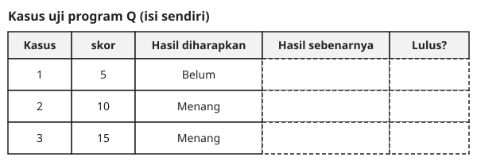

**Ingat dulu:** Tanpa melihat modul:

1. Sebut masukan, proses, dan keluaran pada game saat tombol panah ditekan. ______
2. Sebut dua kasus uji untuk game gerak dan tabrakan, dan hasil yang diharapkan. ______
3. Sebut lima langkah mencari kesalahan dari menjalankan sampai uji ulang. ______



`[Gambar: tabel dengan kolom Kasus, skor, Hasil diharapkan, Hasil sebenarnya, dan Lulus?. Tiga baris: skor 5 diharapkan "Belum", skor 10 diharapkan "Menang", skor 15 diharapkan "Menang". Kolom Hasil sebenarnya dan Lulus? kosong.]`

**Prediksi:** Menguji berarti menjalankan produk dengan masukan yang dipilih dan membandingkan hasilnya dengan yang diharapkan. Aturan game: pemain **menang bila skor 10 atau lebih**, selain itu "Belum". Program Q:

```text
if <(skor) > (10)> then
  say [Menang]
else
  say [Belum]
```

Dari tiga kasus uji pada gambar, yang gagal menurutku kasus ______ .

Telusuri Q pada tiga nilai skor dan isi tabel pada gambar. Mengapa kasus itu yang gagal? ______

**Lengkapi:** Game "Hindari Bola" (rekaan). Kasus uji 2: tombol panah kiri ditekan, harapannya sprite bergeser ke kiri, hasil sebenarnya sprite bergeser ke kanan. Lengkapi umpan balik:

```text setengah-jadi
Saat ______ ditekan, sprite bergerak ke ______, padahal seharusnya ke ______.
Saranku: ______.
```

**Susun:** Lima langkah berikut diacak. Susun urutan uji produk oleh teman.

- **A.** Pembuat membaca umpan balik dan memilih perbaikan.
- **B.** Penguji menulis umpan balik yang berisi.
- **C.** Penguji membaca tujuan game.
- **D.** Pembuat mengubah satu hal lalu menguji ulang.
- **E.** Penguji menjalankan tiap kasus uji dan mencatat hasilnya.

Urutanku: ______ , ______ , ______ , ______ , ______

Mengapa pembuat hanya mengubah satu hal sebelum uji ulang? ______

**Latihan:**

1. Pada program Q yang sudah diperbaiki (`> (9)`), tambahkan kasus skor 9 dan skor 0. Tulis hasil sebenarnya dan apakah lulus. ______
2. Tulis tiga kasus uji untuk game dengan Pemain dan Koin: tombol kanan ditekan, tombol kiri ditekan, dan tidak ada tombol ditekan. ______
3. Ubah "Gamenya aneh" menjadi umpan balik yang berisi untuk game rekaan. ______
4. Dengan dua kalimat, jelaskan mengapa "bagus!" saja kurang membantu pembuat. ______

**Cek diri:**

- [ ] Aku bisa menyebut tiga bagian satu kasus uji.
- [ ] Aku bisa menjelaskan mengapa skor tepat 10 menjadi kasus uji yang penting.
- [ ] Aku bisa menyebut ciri umpan balik yang berisi.

**Catatan cetak (untuk guru, tidak dicetak):** satu lembar A4, dua halaman. Kunci ada di modul `SMP7-2-M11`, bagian "Contoh terselesaikan" dan "Cek mandiri". Lembar tidak memuat kolom nama, kelas, tanggal, atau nilai.
