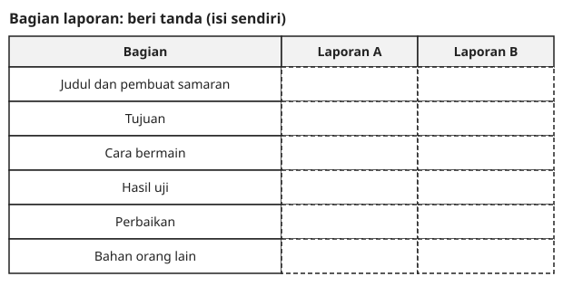

**Ingat dulu:** Tanpa melihat modul:

1. Sebut tiga bagian umpan balik yang berisi. ______
2. Apa beda `broadcast` dan `broadcast and wait`? ______
3. Sebut apa yang dicantumkan untuk bahan orang lain dan tiga hal yang tidak boleh ada di karya yang dibagikan. ______



`[Gambar: tabel tiga kolom Bagian, Laporan A, dan Laporan B. Enam baris bagian: Judul dan pembuat samaran, Tujuan, Cara bermain, Hasil uji, Perbaikan, Bahan orang lain. Kolom Laporan A dan Laporan B kosong untuk diberi tanda.]`

**Prediksi:** Dua laporan tentang game yang sama.

Laporan A:

```text
Gamenya seru banget, dibuat dengan Scratch. Cobain deh.
```

Laporan B:

```text
Judul: Tangkap Koin
Pembuat: Murid-01 (nama samaran)
Tujuan: pemain menangkap koin sebelum nyawa habis.
Cara bermain: 1. Tekan bendera hijau. 2. Gerakkan Pemain dengan panah.
Hasil uji: skor 10 menghasilkan "Menang"; nyawa 0 menghentikan game.
Perbaikan: kondisi menang diganti dari "> 10" menjadi "> 9".
Bahan orang lain: tidak ada.
```

Laporan yang membuat orang lain bisa menjalankan dan menguji game: ______ . Yang kurang pada laporan lainnya: ______

Beri tanda pada tabel di gambar untuk tiap bagian pada kedua laporan. Bagian yang paling membantu penguji: ______

**Lengkapi:** Laporan satu halaman untuk game rekaan "Hindari Bola". Isi dengan kalimatmu sendiri.

```text setengah-jadi
Judul: Hindari Bola
Pembuat: ______ (nama samaran)
Tujuan: ______
Cara bermain: 1. ______ 2. ______
Hasil uji: tiga kasus, tulis masukan dan hasilnya
Perbaikan: ______
Bahan orang lain: ______
```

**Susun:** Enam langkah berikut diacak. Susun urutan membuat laporan satu halaman.

- **A.** Periksa data diri dan atribusi sebelum membagikan.
- **B.** Isi tabel hasil uji.
- **C.** Tulis judul dan nama samaran.
- **D.** Simpan berkas dengan nama yang tidak memuat nama lengkap.
- **E.** Tulis tujuan satu kalimat dan cara bermain sebagai daftar bernomor.
- **F.** Tulis satu perbaikan yang dilakukan.

Urutanku: ______ , ______ , ______ , ______ , ______ , ______

Mengapa memeriksa dilakukan sebelum menyimpan dan membagikan? ______

**Latihan:**

1. Lengkapi Laporan A sampai memuat enam bagian untuk game yang sama. ______
2. Tulis laporan satu halaman untuk game dari `SMP7-2-M8` atau `SMP7-2-M9`: tujuan, cara bermain, tiga kasus uji, satu perbaikan, bahan orang lain.
3. Latih presentasi dua menit dengan pengatur waktu. Sebut tujuan, peragaan, hasil uji, dan satu perbaikan.
4. Dengan dua kalimat, jelaskan mengapa laporan menyebut hasil uji, bukan hanya "berhasil". ______

**Cek diri:**

- [ ] Aku bisa menyebut enam bagian laporan satu halaman.
- [ ] Aku bisa menyebut apa yang diperiksa sebelum laporan dibagikan.
- [ ] Aku bisa menyampaikan produkku dalam dua menit.

**Catatan cetak (untuk guru, tidak dicetak):** satu lembar A4, dua halaman. Kunci ada di modul `SMP7-2-M12`, bagian "Contoh terselesaikan" dan "Cek mandiri". Lembar tidak memuat kolom nama, kelas, tanggal, atau nilai.
