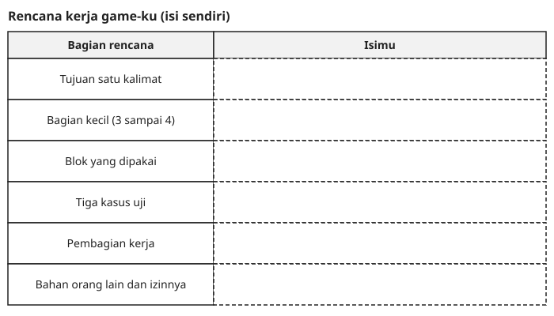

**Ingat dulu:** Tanpa melihat modul:

1. Tulis urutan `ask`, `if`, dan `change` untuk satu soal kuis dan jelaskan mengapa urutannya begitu. ______
2. Sebutkan enam bagian laporan satu halaman. ______
3. Mengapa skor tepat di batas menjadi kasus uji yang penting? ______



`[Gambar: tabel dua kolom Bagian rencana dan Isimu. Enam baris: Tujuan satu kalimat, Bagian kecil (3 sampai 4), Blok yang dipakai, Tiga kasus uji, Pembagian kerja, Bahan orang lain dan izinnya. Kolom Isimu kosong; isi dengan rencana game-mu sendiri pada bagian Lengkapi.]`

**Prediksi:** Program U adalah satu bagian dari game: bola jatuh dari y = 150 sebesar 50 tiap putaran; bila y kurang dari -99, nyawa berkurang dan bola kembali ke atas.

```text
when green flag clicked
set [skor] to (0)
set [nyawa] to (2)
go to x: (0) y: (150)
repeat until <(nyawa) < (1)>
  change [skor] by (1)
  change y by (-50)
  if <(y position) < (-99)> then
    change [nyawa] by (-1)
    go to x: (0) y: (150)
```

Nyawa pertama berkurang pada putaran ke ______ . Skor saat permainan berhenti: ______

Telusuri dengan tabel putaran, `y`, `skor`, dan `nyawa` di kertasmu.

**Lengkapi:** Isi tabel rencana kerja pada gambar untuk game-mu sendiri, lalu tunjukkan ke gurumu sebelum membuat.

**Latihan:**

1. Susun game dari bagian kecil dan uji tiap bagian sebelum menggabungkannya.
2. Jalankan tiga kasus ujimu. Tulis catatan penyebab untuk yang gagal (gejala, penyebab, perbaikan, aturan umum). ______
3. Tulis laporan satu halaman dengan enam bagian dari `SMP7-2-M12`.
4. Pada program U, `set [nyawa] to (2)` diganti `set [nyawa] to (3)`. Permainan berhenti pada putaran ______ dengan skor ______
5. Pada program U, `change y by (-50)` diganti `change y by (-30)`. Nyawa pertama berkurang pada putaran ______
6. Jelaskan game-mu lisan dalam satu menit: tujuan, bagian kecil, satu galat yang kamu temukan, dan satu hal yang akan kamu ubah.

**Cek diri:**

- [ ] Aku punya rencana kerja sebelum membuat.
- [ ] Aku menguji dengan tiga kasus.
- [ ] Aku punya laporan satu halaman tanpa data diri.

**Catatan cetak (untuk guru, tidak dicetak):** satu lembar A4, dua halaman. Bagian Susun dilewati karena modul minggu proyek tidak punya soal urutan. Kunci ada di modul `SMP7-2-M13`, bagian "Contoh terselesaikan" dan "Cek mandiri". Lembar tidak memuat kolom nama, kelas, tanggal, atau nilai.
