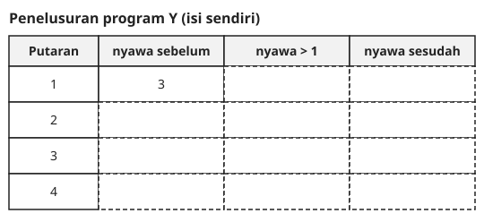

**Ingat dulu:** Tutup semua catatan dan modul. Jawab dulu, baru periksa kunci di modul.

1. Sandikan satu kata tiga huruf dengan lima bit per huruf (A = 1), tanpa melihat contoh. ______
2. Tulis dari ingatan beda `broadcast` dan `broadcast and wait`. ______
3. Jelaskan beda memori dan penyimpanan. ______



`[Gambar: tabel dengan kolom Putaran, nyawa sebelum, nyawa > 1, dan nyawa sesudah. Empat baris putaran 1 sampai 4; hanya nyawa sebelum pada putaran 1 yang sudah berisi 3. Sel lain kosong; isi pada bagian Lengkapi.]`

**Prediksi:** Tulis prediksimu sebelum menelusuri. Program X:

```text
when green flag clicked
set [jumlah] to (0)
delete all of [nilai]
add [4] to [nilai]
add [9] to [nilai]
add [2] to [nilai]
set [i] to (1)
repeat (3)
  if <(item (i) of [nilai]) > (3)> then
    change [jumlah] by (item (i) of [nilai])
  change [i] by (1)
```

`jumlah` pada akhirnya: ______ . `i` pada akhirnya: ______

Lalu telusuri per putaran di kertasmu.

**Lengkapi:** Isi sendiri tabel penelusuran pada gambar untuk program Y.

```text
when green flag clicked
set [nyawa] to (3)
repeat (4)
  if <(nyawa) > (1)> then
    change [nyawa] by (-1)
```

**Latihan** (AI: tanpa AI; kerjakan tanpa catatan, periksa dengan kunci hanya sesudah selesai):

1. Tulis skrip game kecil dari ingatan: skor dan nyawa disiapkan, skor bertambah bila kondisi benar, dan permainan berhenti bila nyawa habis.
2. Program: `repeat (3)` berisi `set [skor] to (0)` lalu `change [skor] by (5)`; harapannya skor akhir 15. Tulis catatan penyebab dan perbaikannya. ______
3. `set [nyawa] to (2)`, lalu `repeat (4)` berisi `change [nyawa] by (-1)` dan `if <(nyawa) = (0)> then say [Habis] for (1) seconds`. Pada putaran berapa sprite mengucap "Habis"? ______
4. Tulis tiga kasus uji untuk game dari soal 1: masukan, hasil yang diharapkan. ______

**Cek diri:** Jurnal refleksi; tulis sendiri di kertasmu dan jangan menulis data pribadi.

- [ ] Soal mana yang paling mudah kujawab, dan mengapa menurutku begitu?
- [ ] Soal mana yang paling sulit atau salah, dan apa satu hal yang akan kulatih ulang?
- [ ] Cara belajar mana yang akan kupakai lagi semester depan?

**Catatan cetak (untuk guru, tidak dicetak):** satu lembar A4, dua halaman. Bagian Susun dilewati karena modul minggu ini berisi kuis mengingat. Kunci "Latihan" ada di modul `SMP7-2-M14`, bagian "Catatan untuk guru". Lembar tidak memuat kolom nama, kelas, tanggal, atau nilai.
