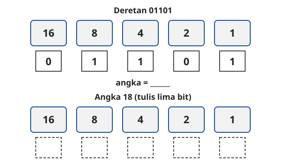

**Ingat dulu:** Tanpa melihat modul:

1. Apa beda data dan informasi? ______
2. Apa yang tersimpan di `(answer)`, dan apa yang terjadi pada isinya saat `ask` kedua berjalan? ______
3. Apa beda `repeat (n)` dan `forever`? ______

`[Gambar: dua baris kartu bernilai 16, 8, 4, 2, 1. Baris pertama diberi bit 0, 1, 1, 0, 1 dengan isian "angka = ______". Baris kedua kosong untuk menulis lima bit bagi angka 18.]`

**Prediksi:** Bit `1` berarti kartu dipasang, bit `0` berarti tidak. Angka adalah jumlah kartu yang terpasang. Angka dari deretan `01101` pada gambar: ______

Mengapa bit paling kiri bernilai paling besar? ______

**Lengkapi:** Baca pesan `01011 01111 10100 00001` dengan aturan huruf ke nomor A = 1, B = 2, ..., Z = 26.

| Bit | Kartu terpasang | Nomor | Huruf |
| --- | --- | --- | --- |
| `01011` | 8 + 2 + 1 | 11 | K |
| `01111` | ______ | ______ | ______ |
| `10100` | ______ | ______ | ______ |
| `00001` | ______ | ______ | ______ |

**Susun:** Lima langkah menyandikan pesan diacak. Susun dalam urutan yang benar; satu langkah mengulang langkah lain.

- **A.** Ambil satu huruf dari pesan.
- **B.** Cari nomor huruf itu (A = 1).
- **C.** Pasang kartu 16, 8, 4, 2, 1 yang jumlahnya sama dengan nomor.
- **D.** Tulis lima bit dari kartu terpasang.
- **E.** Ulangi untuk huruf berikutnya sampai pesan habis.

Urutanku: ______ , ______ , ______ , ______ , ______

Mengapa langkah E ada paling akhir? ______

**Latihan:**

1. Ubah `01101` menjadi `01110`. Angkanya sekarang: ______ , hurufnya: ______
2. Sandikan kata **ADA** menjadi tiga kelompok lima bit. ______
3. Ubah angka 18 menjadi lima bit dengan kartu (tulis pada gambar), lalu cari hurufnya. ______
4. Apa angka terbesar yang bisa ditulis dengan lima bit? Apa yang terjadi bila kamu butuh angka lebih besar? ______
5. Dengan dua kalimat, jelaskan mengapa sandi A = 1 bukan pengaman data. ______

**Cek diri:**

- [ ] Aku bisa mengubah lima bit menjadi angka.
- [ ] Aku bisa menyandikan satu kata.
- [ ] Aku bisa menjelaskan arti kodifikasi.

**Catatan cetak (untuk guru, tidak dicetak):** satu lembar A4, dua halaman. Modul ini pengayaan, tidak termasuk rumusan capaian pembelajaran. Kunci ada di modul `SMP7-2-M2`, bagian "Contoh terselesaikan" dan "Cek mandiri". Lembar tidak memuat kolom nama, kelas, tanggal, atau nilai.
