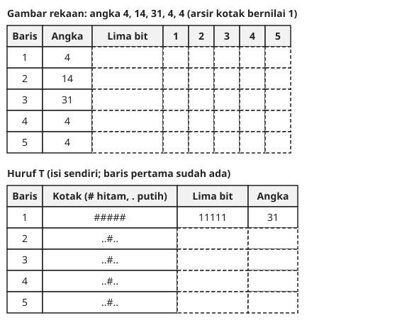

**Ingat dulu:** Tanpa melihat modul:

1. Ubah `01101` menjadi angka dengan kartu 16, 8, 4, 2, 1. ______
2. Apa beda data dan informasi? ______
3. `set [a] to (4)`, lalu `change [a] by (3)`, lalu `change [a] by (-2)`. Berapa isi `a`? ______

`[Gambar: tabel pertama untuk gambar rekaan dengan angka tiap baris 4, 14, 31, 4, 4; kolom Lima bit dan lima kotak 1 sampai 5 kosong. Tabel kedua untuk huruf T: kolom Kotak berisi # (hitam) dan . (putih), kolom Lima bit dan Angka kosong kecuali baris pertama (11111 dan 31).]`

**Prediksi:** Piksel hitam ditulis `1` dan piksel putih `0`. Satu baris lima kotak dibaca sebagai lima bit. Gambar rekaan lima baris dikodekan per baris menjadi angka **4, 14, 31, 4, 4**. Seperti apa gambarnya menurutmu? ______

Sekarang ubah tiap angka pada tabel pertama menjadi lima bit, lalu arsir kotak yang bernilai 1. Cocokkan dengan prediksimu. Bit apa yang menjadi baris pertama? ______

**Lengkapi:** Huruf **T** pada tabel kedua: baris pertama penuh hitam, lalu satu batang di tengah. Isi lima bit dan angka baris 2 sampai 5.

**Susun:** Lima langkah mengubah gambar kisi menjadi angka sudah diacak.

- **A.** Gambar kisi 5 x 5 di kertas.
- **B.** Isi tiap kotak: hitam = 1, putih = 0.
- **C.** Baca satu baris dari kiri ke kanan sebagai lima bit.
- **D.** Ubah lima bit menjadi satu angka dengan kartu 16, 8, 4, 2, 1.
- **E.** Ulangi untuk baris berikutnya sampai kelima baris selesai.

Urutanku: ______ , ______ , ______ , ______ , ______

Mengapa kisi digambar sebelum kotak diisi? ______

**Latihan:**

1. Ubah angka baris ketiga pada gambar rekaan dari 31 menjadi 10. Gambar baru seperti apa? ______
2. Gambar huruf **L** di kisi 5 x 5 dan tulis lima angkanya. ______
3. Satu baris pada kisi 5 x 5 punya berapa kemungkinan susunan kotak? Berapa baris yang kamu butuhkan untuk satu gambar? ______
4. Dengan dua kalimat, jelaskan mengapa gambar berwarna butuh lebih banyak bit per piksel. ______

**Cek diri:**

- [ ] Aku bisa mengubah satu baris kisi menjadi angka.
- [ ] Aku bisa menjelaskan piksel.
- [ ] Aku bisa menjelaskan mengapa warna menambah bit.

**Catatan cetak (untuk guru, tidak dicetak):** satu lembar A4, dua halaman. Kunci ada di modul `SMP7-2-M3`, bagian "Contoh terselesaikan", "Contoh setengah jadi", dan "Cek mandiri". AI: tanpa AI. Lembar tidak memuat kolom nama, kelas, tanggal, atau nilai.
