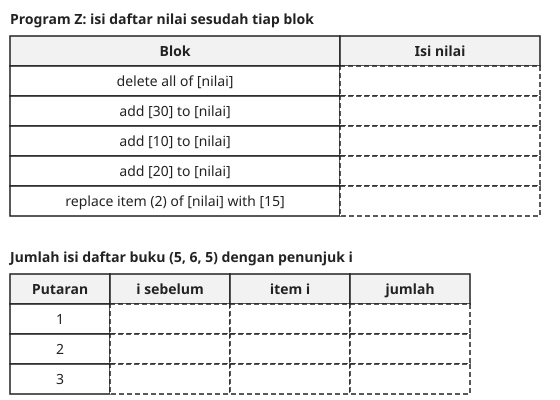

**Ingat dulu:** Tanpa melihat modul:

1. Tulis program yang menghitung skor lewat tiga putaran. ______
2. Ubah `01010` menjadi angka. ______
3. Apa yang dijalankan `if ... else` bila kondisinya salah? ______



`[Gambar: tabel pertama dengan kolom Blok dan Isi nilai; lima baris: delete all, add 30, add 10, add 20, replace item 2 with 15; kolom Isi nilai kosong. Tabel kedua dengan kolom Putaran, i sebelum, item i, jumlah; tiga baris untuk daftar buku berisi 5, 6, 5; semua kolom kecuali Putaran kosong.]`

**Prediksi:** Daftar menyimpan banyak nilai berurutan, nomor urut dimulai dari 1. Program Z:

```text
when green flag clicked
delete all of [nilai]
add [30] to [nilai]
add [10] to [nilai]
add [20] to [nilai]
replace item (2) of [nilai] with [15]
say (item (2) of [nilai]) for (2) seconds
```

Isi `nilai` pada akhirnya: ______ . Yang diucapkan sprite: ______

Telusuri Z dan isi tabel pertama pada gambar. Mengapa `delete all` perlu di awal? ______

**Lengkapi:** Daftar `buku` berisi 5, 6, 5. Isi bagian kosong, lalu telusuri dengan tabel kedua.

```text setengah-jadi
when green flag clicked
set [jumlah] to (0)
set [i] to (______)
repeat (length of [buku])
  change [jumlah] by (item (i) of [buku])
  change [i] by (______)
say (jumlah) for (2) seconds
```

Yang diucapkan sprite: ______

**Susun:** Tujuh baris berikut diacak. Susun menjadi program yang menjumlahkan isi daftar `buku` lalu mengucapkan hasilnya.

- **A.** `when green flag clicked`
- **B.** `set [jumlah] to (0)`
- **C.** `set [i] to (1)`
- **D.** `repeat (length of [buku])`
- **E.** `  change [jumlah] by (item (i) of [buku])` (di dalam `repeat`)
- **F.** `  change [i] by (1)` (di dalam `repeat`)
- **G.** `say (jumlah) for (2) seconds`

Urutanku: ______ , ______ , ______ , ______ , ______ , ______ , ______

Mengapa `set [jumlah]` dan `set [i]` harus sebelum `repeat`? ______

**Latihan:**

1. Pada program jumlah dengan `buku` = 5, 6, 5, tambahkan `add [9] to [buku]` sebelum `set [jumlah] to (0)`. Prediksi ucapan sprite, lalu telusuri. ______
2. Tulis program yang membuat daftar `saudara` berisi 1, 0, 2 dan mengucapkan item nomor 3. ______
3. Pada program jumlah (`buku` = 5, 6, 5), hapus baris `change [i] by (1)`. Telusuri. Apa yang diucapkan? ______
4. Dengan dua kalimat, jelaskan beda variabel biasa dan daftar. ______

**Cek diri:**

- [ ] Aku bisa memakai `add`, `replace`, dan `item`.
- [ ] Aku bisa menelusuri isi daftar dengan tabel.
- [ ] Aku bisa menjumlahkan isi daftar dengan `i`.

**Catatan cetak (untuk guru, tidak dicetak):** satu lembar A4, dua halaman. Kunci ada di modul `SMP7-2-M4`, bagian "Contoh terselesaikan", "Contoh setengah jadi", dan "Cek mandiri". AI: tanpa AI. Lembar tidak memuat kolom nama, kelas, tanggal, atau nilai.
