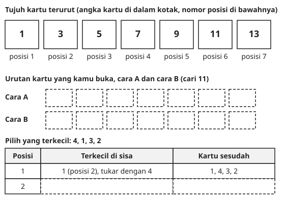

**Ingat dulu:** Tanpa melihat modul:

1. Di Scratch, nomor berapa isi pertama sebuah daftar, dan apa yang diberikan `length of`? ______
2. Ubah `01011` menjadi angka. ______
3. Beri contoh dua langkah yang kalau ditukar urutannya hasilnya berubah. ______

`[Gambar: tujuh kotak kartu terurut 1, 3, 5, 7, 9, 11, 13 dengan posisi 1 sampai 7. Di bawahnya dua baris tujuh kotak kosong berlabel Cara A dan Cara B untuk mencatat kartu yang dibuka saat mencari 11. Lalu tabel pilih yang terkecil untuk kartu 4, 1, 3, 2: baris 1 sudah terisi, baris 2 kosong.]`

**Prediksi:** Tujuh kartu terurut tertelungkup; kamu mencari kartu **11**. Setiap kartu yang dibuka dihitung satu langkah. Cara A: buka dari kiri satu per satu. Cara B: buka kartu paling tengah; bila nilainya lebih kecil dari yang dicari, buang separuh kiri; bila lebih besar, buang separuh kanan; ulangi pada separuh yang tersisa.

Kartu dibuka cara A: ______ . Kartu dibuka cara B: ______

Lakukan kedua cara dan catat kartu yang dibuka pada gambar. Mengapa cara B boleh membuang separuh kartu tanpa membukanya? ______

**Lengkapi:** Urutkan empat kartu 4, 1, 3, 2 dengan strategi **pilih yang terkecil**: untuk tiap posisi dari kiri, cari kartu terkecil di antara kartu yang belum terurut, lalu tukar ke posisi itu. Isi baris 2 pada tabel di gambar, lalu tambahkan baris 3 di sini:

| Posisi | Terkecil di sisa | Kartu sesudah |
| --- | --- | --- |
| 3 | | |

**Susun:** Empat langkah strategi pilih yang terkecil diacak. Langkah pertama membuka pengulangan.

- **A.** Ulangi untuk tiap posisi, dari kiri sampai posisi kedua dari kanan.
- **B.** Cari kartu terkecil di antara kartu yang belum terurut.
- **C.** Tukar kartu itu dengan kartu di posisi sekarang.
- **D.** Anggap posisi sekarang sudah terurut, lalu geser ke posisi berikutnya.

Urutanku: ______ , ______ , ______ , ______

Mengapa langkah C harus sesudah B? ______

**Latihan:**

1. Pada tujuh kartu terurut, cari 5. Berapa kartu dibuka dengan cara A dan cara B? ______
2. Cari 1 dan cari 13 pada tujuh kartu itu. Cara mana lebih cepat untuk tiap nilai? ______
3. Urutkan 6, 2, 5, 1 dengan strategi pilih yang terkecil dan telusuri. ______
4. Dengan dua kalimat, jelaskan mengapa cara B tidak boleh dipakai pada kartu acak. ______

**Cek diri:**

- [ ] Aku bisa menjelaskan dua cara mencari.
- [ ] Aku bisa menelusuri strategi pilih yang terkecil.
- [ ] Aku bisa membandingkan dua strategi dengan banyak langkah.

**Catatan cetak (untuk guru, tidak dicetak):** satu lembar A4, dua halaman. Kunci ada di modul `SMP7-2-M5`, bagian "Contoh terselesaikan", "Contoh setengah jadi", dan "Cek mandiri". AI: tanpa AI. Lembar tidak memuat kolom nama, kelas, tanggal, atau nilai.
